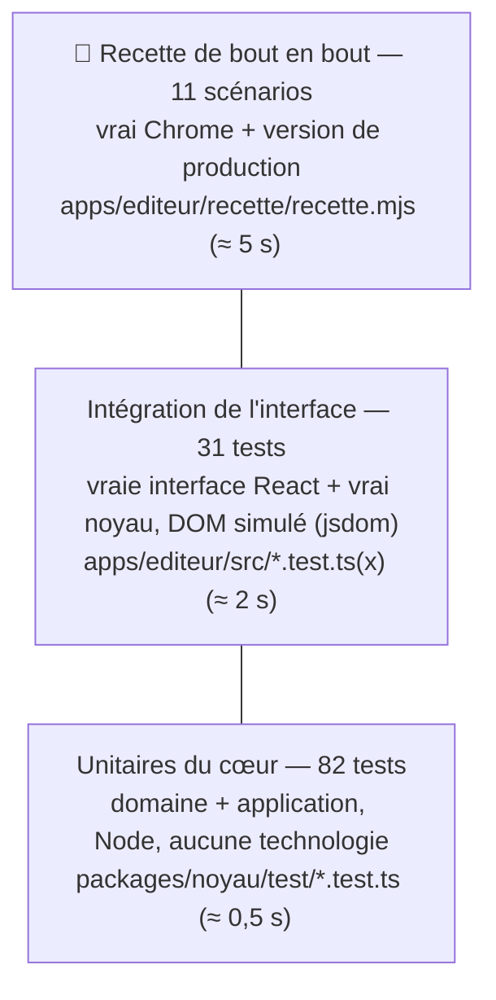
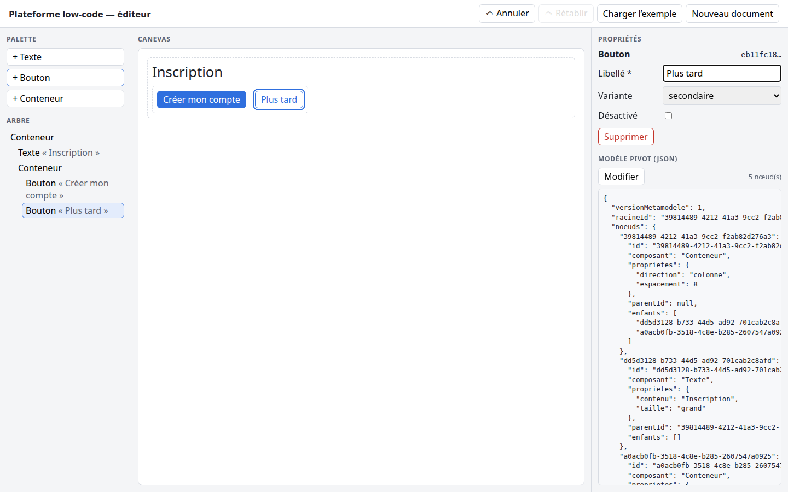

# 09 — Tests et recette

## 1. Stratégie : la pyramide des tests



- **La base est large et rapide** : la logique métier (validation, commandes, service) est testée à fond, sans navigateur. C'est possible **grâce à l'architecture hexagonale** : le cœur ne dépend d'aucune technologie, et les ports sont remplacés par des doublures.
- **Le milieu** vérifie que l'interface est correctement branchée sur le cœur : clics, saisie, affichage, comme le ferait un utilisateur.
- **Le sommet** prouve que tout fonctionne **dans un vrai navigateur**, sur la version construite.

### Deux invariants vérifiés dans **chaque** test de commande

La fonction `appliquer(...)` de `commandes.test.ts` vérifie automatiquement, à chaque appel :
1. **le document reçu n'a pas été modifié** (immuabilité, D7). Le test compare avec une copie faite avant l'appel ;
2. **le document produit est conforme au métamodèle** (`validerDocument(resultat) = []`). C'est le **filet de sécurité** : la validation contrôle les commandes.

Ces deux propriétés sont donc vérifiées **27 fois**, sans qu'il faille y penser dans chaque test.

---

## 2. Lancer les tests

```bash
pnpm test          # 113 tests (noyau + éditeur)
pnpm typecheck     # types de tous les paquets
pnpm build         # construction de production
pnpm recette       # construction + Chrome + scénarios + captures dans docs/reference/captures/ (état actuel)
```

Pour voir le nom de chaque test : `cd packages/noyau && pnpm exec vitest run --reporter=verbose`.

---

## 3. Inventaire des tests (113)

### Noyau — 82 tests

| Fichier | Nombre | Ce qui est couvert |
|---|---|---|
| `catalogue.test.ts` | 6 | Recherche O(1), nom hérité (`toString`) → `undefined`, ordre, propriétés, refus d'un catalogue incohérent (doublon, défaut hors choix) |
| `validation.test.ts` | 35 | Document valide, document de l'étape 2, aller-retour JSON ; **R1** (`null`, `undefined`, chaîne, nombre, tableau, `{}`, mauvaise version, `noeuds` en tableau) ; **R2** (nœud non objet, enfants non textes, clé ≠ id, arrêt sans cascade) ; **R3** (racine absente, racine avec parent, `toString`) ; **R4** ; **R5** (obligatoire absente, facultative absente acceptée, mauvais type, choix non permis, inconnue, valeur non scalaire) ; **R6** ; **R7** (enfant inexistant, mauvais `parentId`) ; **R8** (orphelin, doublon, partage, cycle, **50 000 niveaux sans débordement**) ; toutes les erreurs d'un coup ; `__proto__` |
| `commandes.test.ts` | 27 | Document initial ; **ajouter** (fin, position, positions hors limites −5 et 99, partage structurel, parent inexistant, parent sans enfants, composant inconnu, identifiant déjà utilisé) ; **supprimer** (simple, avec descendants, racine refusée, inexistant) ; **modifier** (nominal, facultative absente, sans effet → même objet, 5 refus) ; **remplacer** (valide, aucun objet partagé, champs en trop retirés, invalide → toutes les erreurs, n'importe quoi) |
| `editeur-applicatif.test.ts` | 14 | Démarrage (dépôt vide, valide, **invalide**), catalogue ; commande réussie / refusée / sans effet ; désabonnement, désabonnement **pendant** une notification ; **même objet tant que rien ne change** ; annuler / rétablir, futur effacé, historique vide, commandes refusées hors historique |

### Éditeur — 31 tests

| Fichier | Nombre | Ce qui est couvert |
|---|---|---|
| `adaptateurs/depot-local-storage.test.ts` | 4 | Rien d'enregistré → `null`, relecture, JSON corrompu → `null`, quota dépassé → pas de plantage |
| `outils-editeur.test.ts` | 9 | `cibleAjout` (4 cas), `resume` (3 cas), validité des documents « exemple » et « vide » |
| `Editeur.test.tsx` | 18 | Affichage initial cohérent (canevas = arbre = JSON), palette issue du catalogue, `flex-direction` ; **S1, S2, S7** ; racine non supprimable ; formulaire généré (select, nombre, case) ; sélection partagée arbre ↔ canevas ; **S3, S4, S5a, S5b** ; abandon du brouillon ; **S6** ; Ctrl+Z / Ctrl+Y ; stockage corrompu ; nouveau document / exemple |

---

## 4. Recette : scénarios d'acceptation de l'étape 13

| N° | Scénario | Attendu | jsdom | **Chrome** |
|---|---|---|---|---|
| S0 | Démarrage à vide | Une racine Conteneur, identifiant **UUID** | ✅ | ✅ |
| S1 | Ajouter un Bouton dans la racine | Nouveau nœud dans le JSON ; `racine.enfants` mis à jour ; `parentId` correct | ✅ | ✅ |
| S2 | Modifier son libellé dans le panneau | JSON mis à jour **à chaque frappe** | ✅ | ✅ |
| S3 | Modifier un libellé dans le JSON + Appliquer | Canevas et arbre mis à jour | ✅ | ✅ |
| S4 | Ajouter un Texte à la main dans le JSON | Il apparaît dans le canevas | ✅ | ✅ |
| S5a | JSON qui viole le métamodèle (Texte avec enfant + choix « fluo ») | Erreurs `ENFANTS_INTERDITS`, `PROPRIETE_CHOIX_INVALIDE`… ; document **et stockage** inchangés | ✅ | ✅ |
| S5b | JSON syntaxiquement faux (virgule supprimée) | « JSON invalide (syntaxe) » ; document inchangé | ✅ | ✅ |
| S6 | Recharger la page | Document conservé | ✅ | ✅ |
| S7 | Supprimer un Conteneur qui a des enfants | Le nœud **et tous ses descendants** disparaissent du JSON | ✅ | ✅ |
| S8 | `pnpm typecheck`, `pnpm test`, `pnpm build` | Aucune erreur, tous les tests passent, l'éditeur se construit | ✅ (113/113, build 240 ko / 75 ko gzip) | — |
| S9 | `import React from 'react'` + `document.title` dans le noyau | `pnpm typecheck` **échoue** avec `TS2307 Cannot find module 'react'` et `TS2584 Cannot find name 'document'` (puis on retire les lignes) | ✅ | — |
| Bonus | Ctrl+Z restaure un Conteneur supprimé, Ctrl+Y le resupprime | | ✅ | ✅ |
| Démo | Construire une interface **uniquement à la souris** (titre + rangée de 2 boutons) | 5 nœuds, propriétés correctes | — | ✅ |

Dans Chrome : **aucune erreur dans la console** pendant toute la recette (elle est vérifiée automatiquement).

---

## 5. Captures (dans [captures/](captures/))

| Fichier | Contenu |
|---|---|
| `01-document-initial.png` | Démarrage : une racine vide, identifiant UUID dans le JSON |
| `02-exemple-charge.png` | Le document de l'étape 2 : canevas, arbre et JSON cohérents |
| `03-s1-bouton-ajoute.png` | S1 : un Bouton ajouté à la racine, sélectionné, visible dans le JSON |
| `04-s2-proprietes.png` | S2 : le libellé « Confirmer » saisi dans le panneau |
| `05-s4-ajout-par-json.png` | S4 : un Texte « Écrit dans le JSON » ajouté **dans le modèle**, affiché dans le canevas |
| `06-s5-erreurs-metamodele.png` | S5a : 4 erreurs de validation listées avec code, message et lien « voir » |
| `07-s5-erreur-syntaxe.png` | S5b : message d'erreur de syntaxe JSON |
| `08-s7-suppression.png` | S7 : le Conteneur et ses descendants supprimés |
| `09-demo-construction-souris.png` | Une interface d'inscription construite à la souris (pour la présentation) |



---

## 6. Ce que les tests ne couvrent pas (honnêtement)

- **L'apparence visuelle** (CSS) n'est pas vérifiée automatiquement. Elle est contrôlée à l'œil sur les captures.
- Les **navigateurs autres que Chrome** n'ont pas été testés automatiquement. Firefox est installé, et l'application n'utilise que des API standard (`localStorage`, `crypto.randomUUID`).
- Les **performances** sur de très gros documents (plus de 10 000 nœuds) n'ont pas été mesurées. La complexité est analysée dans [06](06-structures-de-donnees-et-complexite.md).
