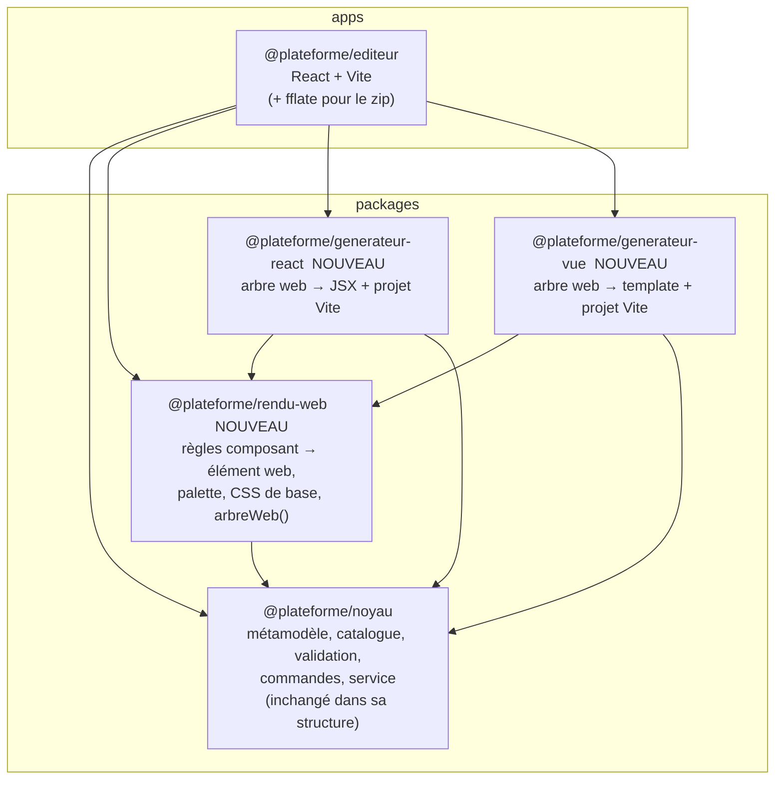
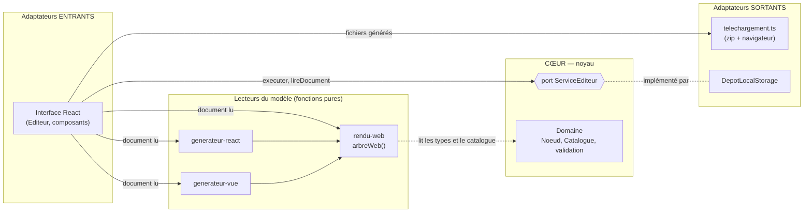
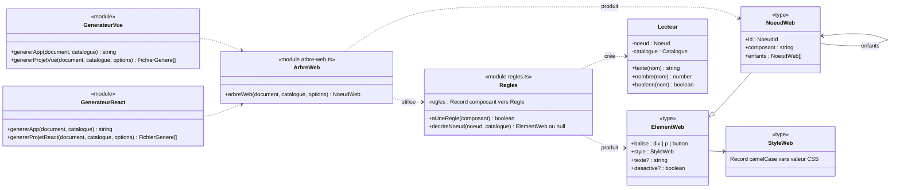
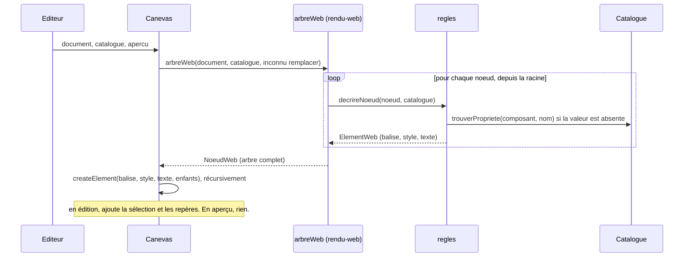
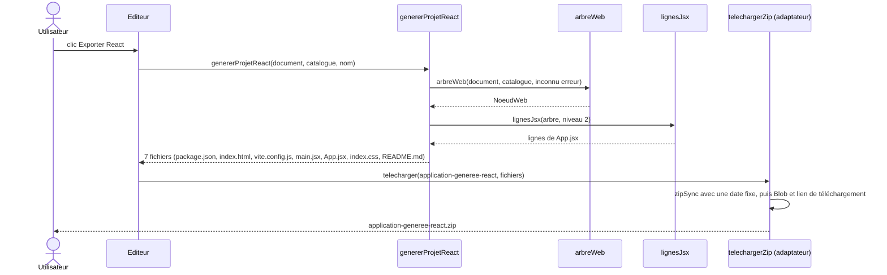
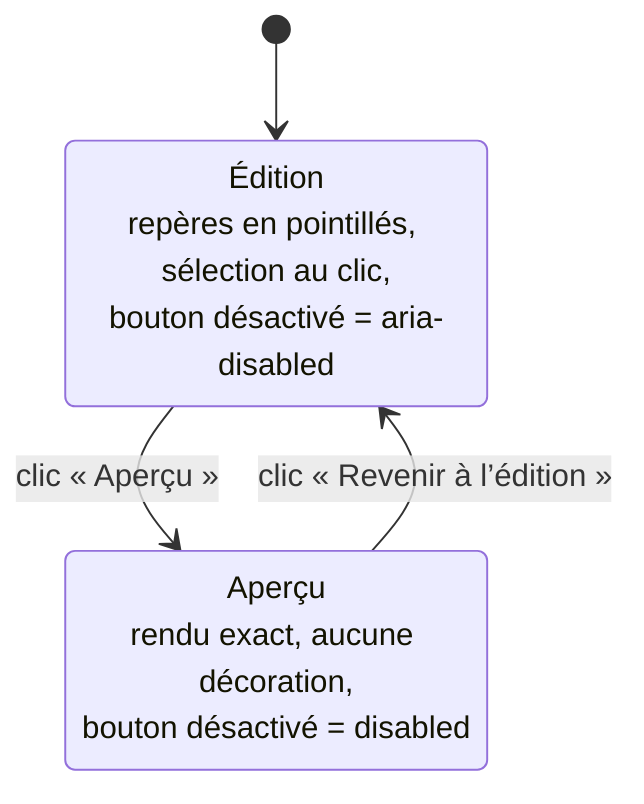
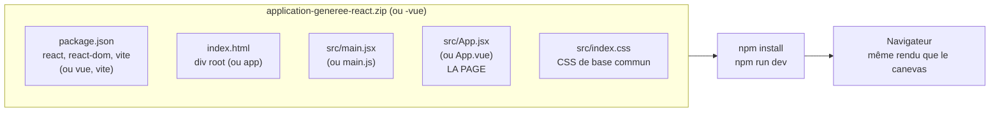

# 02 — Conception : l'architecture à la fin de la phase 2

> Ce document décrit l'architecture **telle qu'elle est à la fin de la phase 2**. Celle de la phase 1 reste visible dans [phase 1 › 03](../01-phase-1-modele-pivot-et-editeur/03-conception-architecture.md) ; comparer les deux montre l'évolution.
> Ce qui **n'a pas changé** (le noyau, les commandes, la validation, le service, le circuit d'une commande) n'est pas répété.

---

## 1. Ce qui change en une phrase

On ajoute **trois paquets** autour du noyau, **sans modifier sa structure** : un paquet de **règles de rendu web** partagées, et **deux générateurs**. L'éditeur s'en sert pour afficher le canevas et pour exporter.

---

## 2. Les paquets du monodépôt

| Paquet | Dépend de | Types du navigateur ? | Rôle |
|---|---|---|---|
| `noyau` | rien | non | Le cœur (phase 1) |
| `rendu-web` | `noyau` | **non** | Les règles « modèle → web », partagées |
| `generateur-react` | `noyau`, `rendu-web` | **non** | Modèle → projet React |
| `generateur-vue` | `noyau`, `rendu-web` | **non** | Modèle → projet Vue |
| `editeur` | tous | oui | L'interface, et les adaptateurs du navigateur |

Les trois nouveaux paquets sont compilés **comme le noyau** : sans les types du navigateur (`"lib": ["ES2022"]`). Ce sont des **fonctions pures** (document → données, ou document → texte). Ils pourront donc tourner **sur un serveur** (export côté serveur, intégration continue) sans aucune modification.

**Règle de dépendance respectée** : toutes les flèches vont vers le noyau. Le noyau ne connaît ni les règles web ni les générateurs.

---

## 3. Où se placent les nouveaux paquets dans l'hexagone

**Choix d'architecture** : les générateurs **ne passent pas par le service**. Ils reçoivent un document **déjà lu** (immuable) et ne le modifient jamais. Ce sont des **lecteurs** du modèle, comme le canevas. Les faire passer par le noyau aurait obligé à **modifier** le noyau (un nouveau port « exporter »), ce que l'objectif O12 voulait éviter. Plus tard, un export côté serveur appellera les mêmes fonctions depuis un autre adaptateur.

---

## 4. Diagramme de classes : la représentation web commune

---

## 5. Diagrammes de séquence

### 5.1 Afficher le canevas (après la phase 2)

### 5.2 Exporter en React

Si un composant n'a pas de règle, `arbreWeb` lève `ErreurRendu`. L'éditeur affiche `EXPORT_IMPOSSIBLE`, et **aucun** fichier n'est produit.

---

## 6. L'état du canevas : édition et aperçu

---

## 7. Le projet généré (déploiement)

Le projet généré est **indépendant de la plateforme** : il ne dépend d'aucun paquet `@plateforme/*`. Le concepteur en est **propriétaire** et peut le modifier, l'héberger ou le versionner comme il veut. C'est la réponse aux limites L1 (propriété du code) et L7 (dépendance au fournisseur) de l'étude de l'existant.
