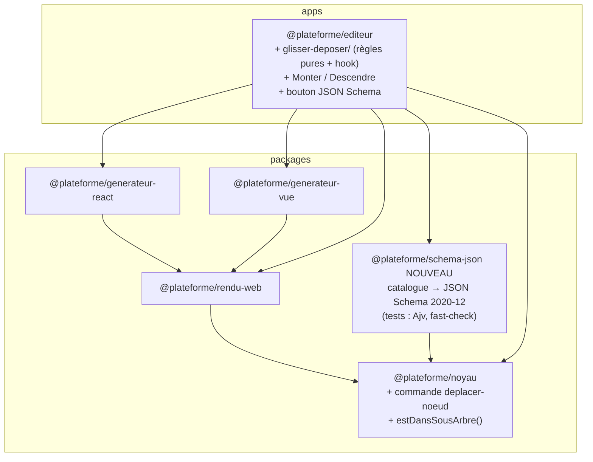
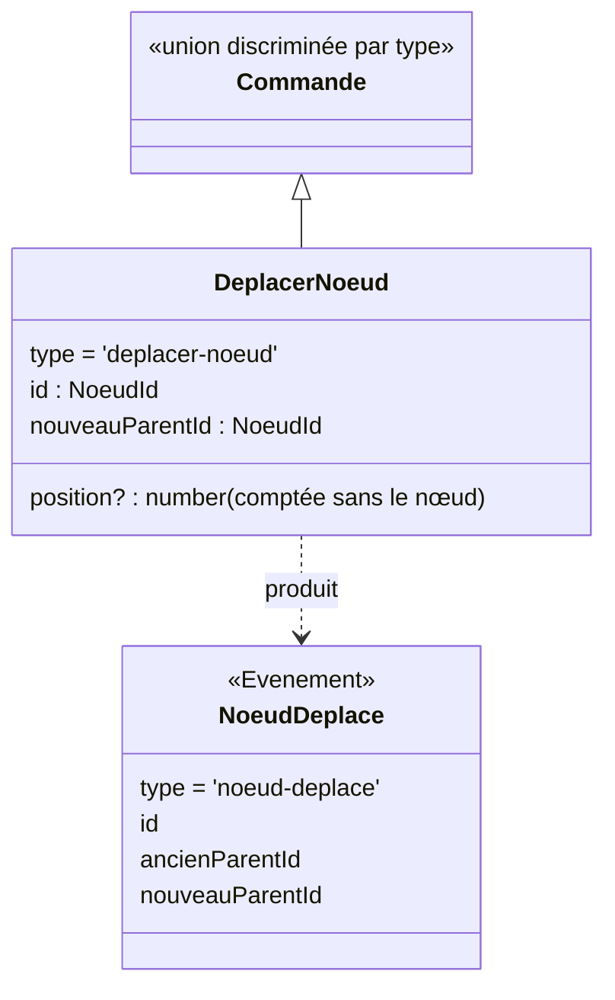
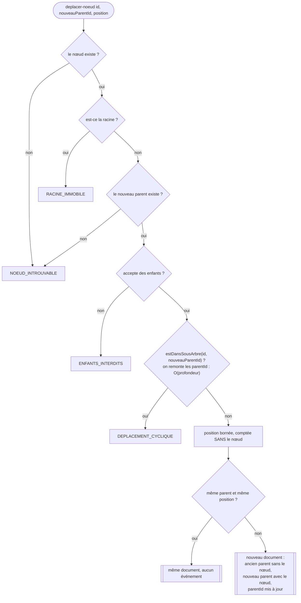
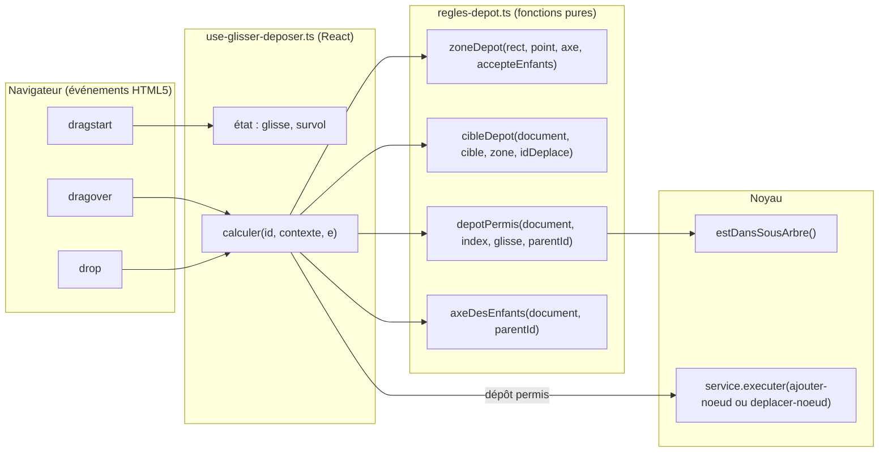
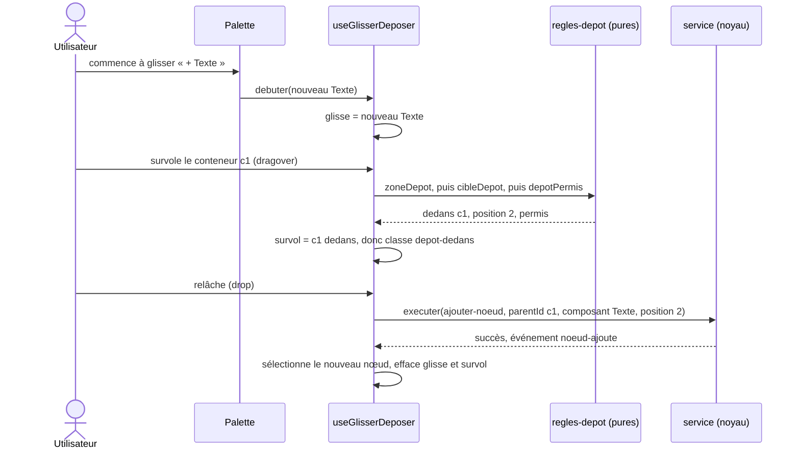
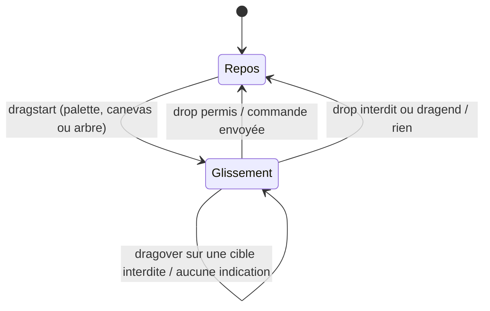
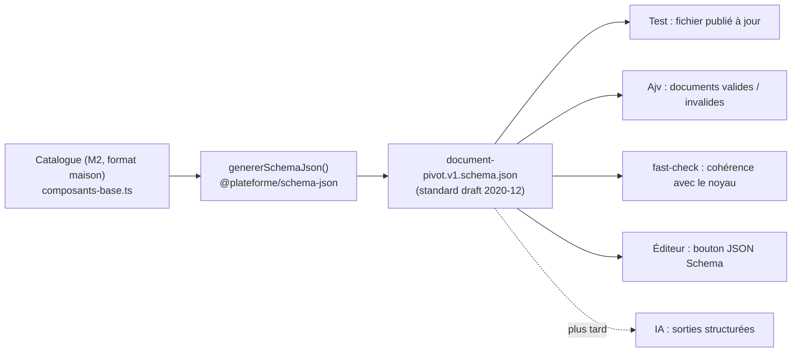

# 02 — Conception : l'architecture à la fin de la phase 3

> Ce qui **change** par rapport à la phase 2 ([phase 2 › 02](../02-phase-2-generateurs-react-vue/02-conception-architecture.md)). Ce qui ne change pas n'est pas répété.

---

## 1. En une phrase

Le **noyau** gagne une commande (`deplacer-noeud`) et une requête (`estDansSousArbre`). L'**éditeur** gagne le glisser-déposer, construit sur des **règles pures**. Un nouveau paquet **lit le catalogue** et produit le **JSON Schema**.

## 2. Les paquets

`schema-json`, comme les générateurs, est un **lecteur** : il lit le **catalogue** (le métamodèle, M2), alors que les générateurs lisent le **document** (le modèle, M1). Le noyau ne dépend pas de lui. Il est compilé sans les types du navigateur ni de Node ; seuls ses **tests** ont les types de Node (D69).

## 3. La commande `deplacer-noeud`

### Activité : vérifications, dans l'ordre

## 4. Le glisser-déposer : deux couches

- **Les décisions** (où ça tombe, est-ce permis ?) sont des **fonctions pures**, testées sans navigateur : 15 tests.
- **Le hook** ne fait que lire la souris et appeler les fonctions pures, puis envoyer **la même commande** qu'un clic. Le noyau n'a donc **rien** de spécial à savoir : le glisser-déposer est un **nouvel adaptateur entrant**.
- **Double protection** : l'interface refuse un dépôt cyclique, et le noyau le refuserait de toute façon (D60).

### Séquence : glisser « + Texte » dans un conteneur

### États d'un glissement

## 5. Le JSON Schema

Les principes, la table de traduction et **les limites** sont dans [03-json-schema-et-ses-limites.md](03-json-schema-et-ses-limites.md).
