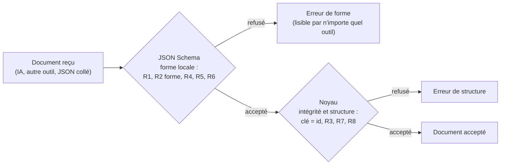

# 03 — Le métamodèle en JSON Schema : principes, traduction et limites

> Ce document explique ce qu'est un **JSON Schema**, comment notre **catalogue** y est traduit **automatiquement**, et surtout **ce que JSON Schema ne peut pas exprimer**, d'où la nécessité de garder le validateur du noyau.

---

## 1. Le document pivot et le schéma : deux choses différentes

| | Document pivot | JSON Schema |
|---|---|---|
| Ce que c'est | **Une** interface précise (ce que tu dessines) | **Les règles** que tout document doit respecter |
| Niveau | **M1** (modèle) | **M2** (métamodèle) |
| Exemple | `"couleur": "succes"` | `"couleur": { "enum": ["primaire", "secondaire", "succes", "danger", "neutre"] }` |
| Image | Un formulaire **rempli** | Le formulaire **vierge**, avec ses consignes |

## 2. Pourquoi publier le métamodèle dans un standard

Avant cette phase, les règles existaient déjà, mais dans **notre format maison** (le catalogue) et dans **notre code** (`validerDocument`). Seul notre programme pouvait les lire.

**JSON Schema** est un **standard public** ([json-schema.org](https://json-schema.org), version *draft 2020-12*), avec un vocabulaire fixe : `type`, `properties`, `required`, `enum`, `minimum`, `const`, `oneOf`, `$ref`… Il est compris par des centaines d'outils, dans tous les langages.

| Usage | Ce que le schéma permet |
|---|---|
| **Le mémoire** | Montrer le métamodèle sous une forme **formelle et standard**, et pas seulement « dans le code » |
| **L'IA (OG4, OG5)** | Les modèles de langage savent produire une réponse **contrainte par un JSON Schema** (« sorties structurées »). L'IA ne peut alors produire qu'un document de la bonne forme. Le noyau vérifie ensuite le reste (§5) |
| **L'interopérabilité** | Un autre outil (en Python, en Java…) peut valider nos documents sans notre code |
| **La documentation** | Les éditeurs de code (VS Code) proposent l'autocomplétion et signalent les erreurs dans un fichier JSON relié au schéma |

## 3. La traduction automatique : catalogue → JSON Schema

Le paquet `@plateforme/schema-json` **lit le catalogue** et **produit** le schéma. On ne l'écrit **jamais à la main** : les deux ne peuvent donc pas se contredire. Un test échoue si le fichier publié n'est plus à jour.

### 3.1 Les propriétés

| Notre catalogue (format maison) | JSON Schema (standard) |
|---|---|
| `{ type: 'texte', defaut: 'Bouton' }` | `{ "type": "string", "default": "Bouton" }` |
| `{ type: 'nombre', min: 0 }` | `{ "type": "number", "minimum": 0 }` |
| `{ type: 'booleen', defaut: false }` | `{ "type": "boolean", "default": false }` |
| `{ type: 'choix', choix: ['petit', 'moyen', 'grand'] }` | `{ "type": "string", "enum": ["petit", "moyen", "grand"] }` |
| `libelle: 'Libellé'` | `"title": "Libellé"` |
| `obligatoire: true` | le nom figure dans `"required": [...]` |
| propriété non déclarée | `"additionalProperties": false` |

### 3.2 Les composants

Chaque composant devient une **définition** dans `$defs`. Un nœud doit correspondre à **exactement une** définition (`oneOf`) ; le champ `composant` est fixé par `const`, ce qui joue le rôle de **discriminant** :

```json
"$defs": {
  "Noeud": { "oneOf": [ { "$ref": "#/$defs/Texte" }, { "$ref": "#/$defs/Bouton" }, { "$ref": "#/$defs/Conteneur" } ] },
  "Bouton": {
    "type": "object",
    "required": ["id", "composant", "proprietes", "parentId", "enfants"],
    "additionalProperties": false,
    "properties": {
      "composant": { "const": "Bouton" },
      "parentId": { "type": ["string", "null"] },
      "enfants": { "type": "array", "maxItems": 0 },
      "proprietes": { "…": "voir §3.1" }
    }
  }
}
```

`"enfants": { "maxItems": 0 }` exprime « un Bouton n'accepte pas d'enfants » (règle R6). Pour un Conteneur, c'est un tableau de textes, sans limite.

### 3.3 Le document

```json
{
  "$schema": "https://json-schema.org/draft/2020-12/schema",
  "type": "object",
  "required": ["versionMetamodele", "racineId", "noeuds"],
  "additionalProperties": false,
  "properties": {
    "versionMetamodele": { "const": 1 },
    "racineId": { "type": "string" },
    "noeuds": { "type": "object", "additionalProperties": { "$ref": "#/$defs/Noeud" } }
  }
}
```

Le fichier complet est publié dans `packages/schema-json/schema/document-pivot.v1.schema.json`. On peut aussi le télécharger depuis l'éditeur, avec le bouton « ⤓ JSON Schema ».

## 4. Ce que JSON Schema **ne peut pas** exprimer

C'est le point le plus important de cette phase, et une **vraie subtilité théorique**.

JSON Schema décrit très bien la **forme** de chaque valeur, **localement** : « ce champ est un texte », « cette liste est vide », « cette valeur fait partie de cette liste ». Mais il ne sait pas relier **deux endroits** du document entre eux.

| Règle du noyau | Exprimable en JSON Schema ? | Pourquoi |
|---|---|---|
| R1 — forme générale, version 1 | ✅ Oui | `type`, `required`, `const` |
| R2 — forme de chaque nœud | ✅ Oui | idem |
| R2 — **la clé d'un nœud est égale à son `id`** | ❌ **Non** | Il faudrait comparer la **clé** d'un objet à une **valeur** à l'intérieur. JSON Schema n'a aucun mot-clé pour cela |
| R3 — **la racine existe** dans `noeuds` | ❌ **Non** | « la valeur de `racineId` est une clé de `noeuds` » est une **référence** entre deux endroits du document |
| R4 — composant connu | ✅ Oui | `oneOf` + `const` |
| R5 — propriétés (obligatoires, types, choix, bornes, inconnues) | ✅ Oui | `required`, `type`, `enum`, `minimum`, `additionalProperties` |
| R6 — pas d'enfants pour un Texte ou un Bouton | ✅ Oui | `maxItems: 0` |
| R7 — **chaque enfant existe et pointe vers son parent** | ❌ **Non** | Référence croisée entre deux nœuds |
| R8 — **chaque nœud est atteint exactement une fois** (pas de cycle, pas d'orphelin) | ❌ **Non** | Propriété **globale** du graphe : il faut le **parcourir** |

### Pourquoi ? La distinction locale / globale

- **Contrainte locale** : se vérifie en regardant **une valeur à la fois** (« c'est un nombre ≥ 0 »). C'est le domaine de JSON Schema.
- **Contrainte d'intégrité référentielle** : relie **deux valeurs** (« cet identifiant désigne un nœud qui existe »). C'est l'équivalent des **clés étrangères** d'une base de données.
- **Contrainte globale** : porte sur **toute la structure** (« c'est un arbre »). Il faut un **algorithme** (notre parcours en profondeur avec une pile).

En ingénierie des modèles, ces contraintes non structurelles s'écrivent dans un langage dédié, comme **OCL** (*Object Constraint Language*). JSON Schema est l'équivalent du **diagramme de classes** : il décrit la structure, pas les invariants qui relient les objets. Notre noyau joue le rôle d'**OCL** ([phase 1 › 04 §4](../01-phase-1-modele-pivot-et-editeur/04-metamodele.md)).

### La conséquence : une validation en **deux couches**



**Le schéma est une condition nécessaire, pas suffisante.** Il filtre tôt et de façon standard (par exemple directement dans la sortie de l'IA). Le noyau reste le **dernier rempart** : rien n'entre sans lui (D9).

## 5. Strict dans ce qu'on produit, tolérant dans ce qu'on accepte

Une seule différence volontaire existe, **dans l'autre sens** : un champ **en trop** dans la structure (par exemple `"commentaire"` à la racine du document).

| | Schéma | Noyau |
|---|---|---|
| Champ structurel en trop | **Refusé** (`additionalProperties: false`) | **Toléré**, puis **retiré** à la copie (D17) |

C'est le **principe de robustesse** de Jon Postel (RFC 761, 1980) : *« sois conservateur dans ce que tu envoies, libéral dans ce que tu acceptes »*. Le schéma décrit la forme **canonique**, celle qu'on veut que l'IA et les outils **produisent**. Le noyau, lui, accepte un document légèrement « sale » et le **nettoie**.

## 6. La preuve de cohérence : tests par propriétés

Deux propriétés sont vérifiées sur des documents **générés au hasard** (fast-check) :

1. **Tout document produit par les commandes est accepté par le schéma.** 200 suites aléatoires de commandes, passées par le **vrai** service, avec une vérification après **chaque** commande.
2. **Sur 1 000 documents corrompus au hasard** :
   - si le noyau trouve un défaut **exprimable**, le schéma refuse ;
   - si le schéma refuse, le noyau refuse aussi.

**Répartition mesurée** des 1 000 documents corrompus :

| Résultat | Nombre | Interprétation |
|---|---|---|
| Schéma refuse, noyau refuse (défaut exprimable) | **845** | Accord |
| Schéma accepte, noyau accepte | **104** | Corruption sans conséquence (une couleur valide remplacée par une autre) |
| Schéma accepte, noyau refuse (défaut **non exprimable** seulement) | **51** | **Exactement** la limite du §4 : liens incohérents, orphelins, cycles |
| Contradiction | **0** | — |

Les limites du §4 sont aussi testées **une par une**, par 6 tests explicites qui vérifient que le schéma accepte et que le noyau refuse.

## 7. Comment l'IA utilisera ce schéma (pour plus tard)

1. On donne au modèle de langage la **demande** (« un formulaire d'inscription ») **et** le **schéma**.
2. Le modèle produit un JSON **contraint** par le schéma (sorties structurées) : pas de composant inventé, pas de couleur « rose ».
3. Le noyau vérifie l'intégrité (§4) : liens, racine, arbre.
4. Le document entre par la commande `remplacer-document`, ou mieux, par une suite de commandes, pour être **annulable**.

## 8. Lectures

- JSON Schema, *draft 2020-12* : [json-schema.org/specification](https://json-schema.org/specification). Cours : *Understanding JSON Schema*.
- Pezoa F., Reutter J., Suarez F., Ugarte M., Vrgoč D. (2016), *Foundations of JSON Schema*, WWW 2016 : expressivité formelle de JSON Schema.
- OMG, *Object Constraint Language (OCL)* 2.4 : les contraintes que la structure ne sait pas exprimer.
- Postel J. (1980), *RFC 761 — DoD Standard Transmission Control Protocol*, §2.10 : le principe de robustesse.
- Claessen K., Hughes J. (2000), *QuickCheck: A Lightweight Tool for Random Testing of Haskell Programs*, ICFP : l'origine des tests par propriétés.
