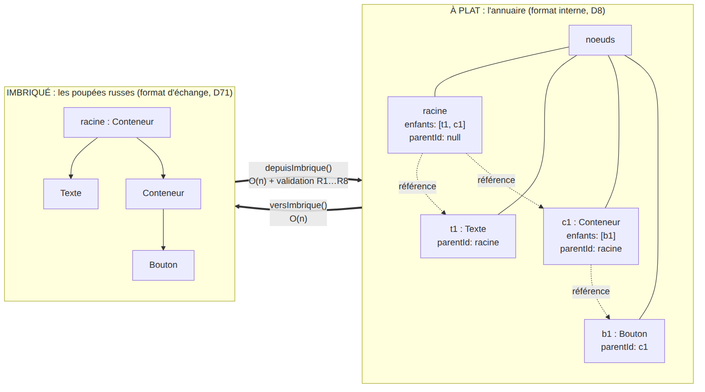
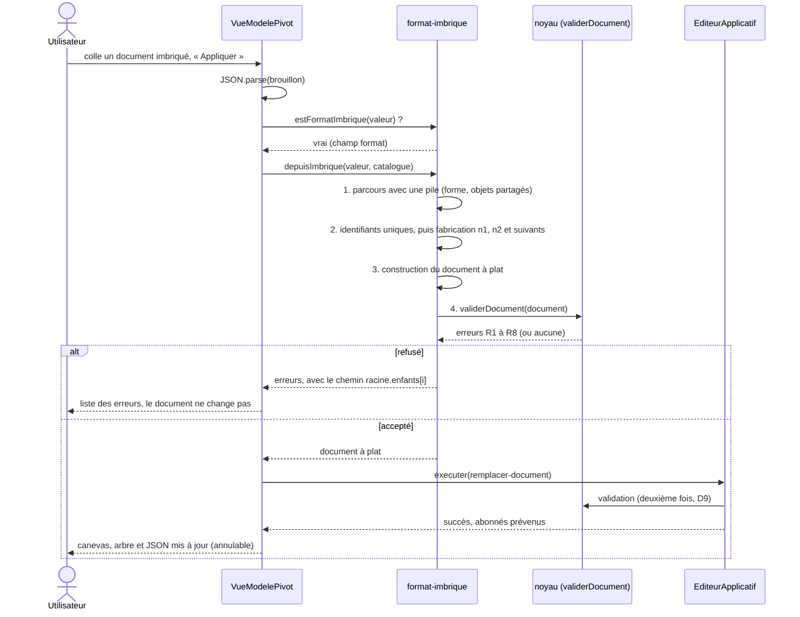
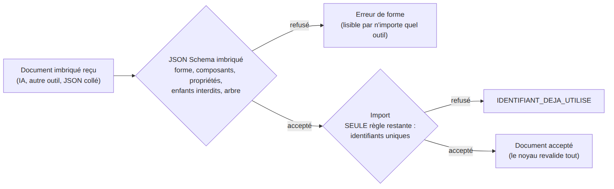
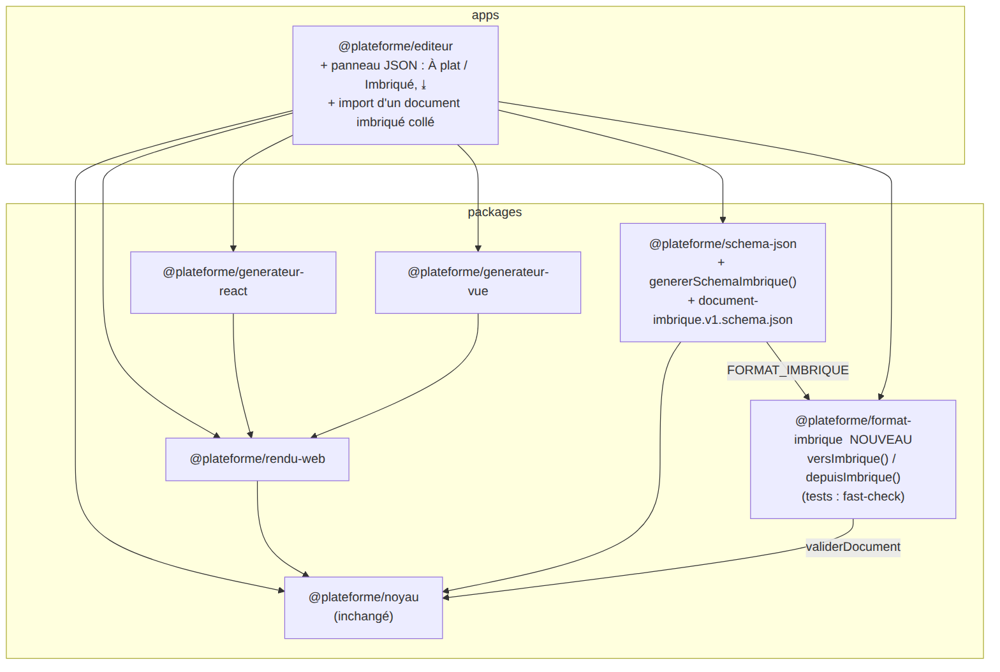

# 02 — Conception et théorie : à plat, imbriqué, et ce que JSON Schema peut enfin vérifier

## 1. Le même arbre, écrit de deux façons

Une page contient un texte et un conteneur, qui contient un bouton.

**À plat** (l'annuaire, format interne depuis la phase 1, D8) :

```json
{
  "versionMetamodele": 1,
  "racineId": "racine",
  "noeuds": {
    "racine": { "id": "racine", "composant": "Conteneur", "proprietes": {}, "parentId": null, "enfants": ["t1", "c1"] },
    "t1":     { "id": "t1", "composant": "Texte", "proprietes": { "contenu": "Bonjour" }, "parentId": "racine", "enfants": [] },
    "c1":     { "id": "c1", "composant": "Conteneur", "proprietes": {}, "parentId": "racine", "enfants": ["b1"] },
    "b1":     { "id": "b1", "composant": "Bouton", "proprietes": { "libelle": "OK" }, "parentId": "c1", "enfants": [] }
  }
}
```

**Imbriqué** (les poupées russes, format d'échange, D71) :

```json
{
  "format": "pivot-imbrique",
  "versionMetamodele": 1,
  "racine": {
    "id": "racine", "composant": "Conteneur", "proprietes": {},
    "enfants": [
      { "id": "t1", "composant": "Texte", "proprietes": { "contenu": "Bonjour" } },
      { "id": "c1", "composant": "Conteneur", "proprietes": {},
        "enfants": [ { "id": "b1", "composant": "Bouton", "proprietes": { "libelle": "OK" } } ] }
    ]
  }
}
```



**Les deux formes sont aussi structurées l'une que l'autre.** Elles décrivent le même arbre. La différence est **la manière de relier un parent à ses enfants** :
- à plat, par une **référence** (un identifiant à aller chercher dans l'annuaire) ;
- imbriqué, par la **position** dans le texte (l'enfant est écrit **dans** son parent).

## 2. Qui est meilleur pour quoi

| Opération | À plat | Imbriqué |
|---|---|---|
| Trouver un nœud par son identifiant | **O(1)** | O(n) : il faut fouiller |
| Modifier un nœud sans toucher l'original (D7) | Recopier **le nœud** et la table | Recopier **tout le chemin** depuis la racine |
| Déplacer un nœud | Deux listes `enfants` et un `parentId` | Extraire d'une branche, réinsérer dans une autre |
| Trouver le parent (Monter, cycle, D54) | Lire `parentId` | Impossible sans tout reparcourir |
| Garder une sélection, un historique | L'identifiant ne change jamais | Un chemin (« 2ᵉ enfant du 1ᵉʳ ») change à chaque déplacement |
| **Lien cassé, cycle, orphelin, deuxième racine** | **Possibles**, il faut les règles R3, R7, R8 | **Impossibles** à écrire en JSON |
| **Vérifiable par JSON Schema** | Partiellement (phase 3) | **Presque entièrement** (§5) |
| Lisible par un humain | Il faut suivre les identifiants | On voit l'arbre |
| Facile à produire pour une IA | Il faut des identifiants cohérents partout | Il suffit d'écrire l'arbre |

**Conclusion (D71)** : on **garde** le format à plat **à l'intérieur**, pour éditer, et on **ajoute** le format imbriqué **pour échanger**. C'est le même principe que les bases de données, qui stockent à plat (des tables et des clés étrangères) mais échangent souvent des documents imbriqués (JSON, XML).

## 3. Le format imbriqué, champ par champ

| Champ | Obligatoire ? | Rôle |
|---|---|---|
| `format` | Oui, toujours `"pivot-imbrique"` | Dit **explicitement** de quel format il s'agit (D78). L'éditeur s'en sert pour choisir l'import |
| `versionMetamodele` | Oui, `1` | Même version que le format à plat : c'est le **même** métamodèle |
| `racine` | Oui | Le nœud racine, qui contient tout le reste |
| nœud `.composant` | Oui | Le type, comme à plat |
| nœud `.proprietes` | Oui pour le schéma, toléré absent à l'import | Comme à plat |
| nœud `.enfants` | **Absent** pour un Texte ou un Bouton ; **facultatif** pour un Conteneur (absent = aucun enfant) | Les enfants **eux-mêmes**, dans l'ordre (D73) |
| nœud `.id` | **Facultatif** | Absent, il est fabriqué à l'import (D72) |

Il n'y a **ni** `parentId`, **ni** `racineId`, **ni** clé d'annuaire : ce sont précisément les champs qui permettaient de « se perdre ».

## 4. Les deux conversions

### 4.1 À plat → imbriqué : `versImbrique(document, { ids? })`

On part de la racine avec une **pile** de couples (nœud à plat, copie imbriquée). Pour chaque nœud retiré de la pile, on crée la copie de chacun de ses enfants, on l'ajoute à `enfants` dans l'ordre, et on empile le couple.

- **Complexité** : O(n + e). Chaque nœud et chaque lien sont visités une fois, et chaque accès à l'annuaire est en O(1).
- **Itératif** : pas de récursion, donc pas de débordement de la pile d'appels, même à 50 000 niveaux (D75).
- **Document supposé valide** : il vient du noyau, qui l'a déjà vérifié.
- `{ ids: false }` donne un **arbre pur**, sans aucun identifiant : la forme la plus simple à faire produire par une IA.

### 4.2 Imbriqué → à plat : `depuisImbrique(candidat, catalogue)`

L'entrée vient de l'extérieur : **on ne lui fait pas confiance** (D9). Quatre étapes :

1. **Parcours en profondeur avec une pile**, dans l'ordre de lecture. On vérifie la forme de chaque nœud. Un ensemble des objets déjà vus détecte un **même objet rencontré deux fois**. C'est impossible depuis du texte JSON, mais possible si un programme passe un objet JavaScript partagé ou circulaire ; sans cette garde, le parcours bouclerait à l'infini (D75).
2. **Identifiants** : ceux fournis doivent être **uniques**. C'est la seule règle globale qui reste. Les autres sont **fabriqués** : `n1`, `n2`… dans l'ordre de lecture, en sautant ceux déjà pris (D72).
3. **Construction** du document à plat : `parentId` et `enfants` sont **calculés** à partir de la position, donc cohérents par construction. On utilise `Object.fromEntries`, qui crée de vraies propriétés même pour une clé piège comme `__proto__`.
4. **Validation complète par le noyau** (`validerDocument`, R1 à R8) : catalogue, propriétés, enfants interdits… On ne réécrit aucune règle (D74). Chaque erreur reçoit le **chemin** du nœud fautif, par exemple `(racine.enfants[1].enfants[0])`. On retire l'identifiant d'une erreur s'il a été **fabriqué** : il ne dit rien à l'auteur, et pourrait désigner par hasard un autre nœud de l'éditeur (P4-06).

- **Complexité** : O(n + e) pour les étapes 1 à 3, plus la validation, elle aussi en O(n + p + e). Le chemin d'un nœud coûte O(profondeur), mais il n'est calculé **que pour les erreurs**. Le calculer pour chaque nœud aurait coûté O(n × profondeur) en mémoire, soit des milliards de caractères pour 50 000 niveaux.



## 5. Le schéma imbriqué, et les limites de la phase 3 qui disparaissent

Le schéma est **récursif** : un Conteneur a `enfants: { type: "array", items: { "$ref": "#/$defs/Noeud" } }`, et `Noeud` est un `oneOf` de Texte, Bouton et Conteneur (comme D65). Les propriétés sont traduites par **le même code** que pour le format à plat (`schemaProprietes`), donc les deux schémas ne peuvent pas diverger.

| Limite du format à plat ([phase 3 › 03 §4](../03-phase-3-deplacement-et-json-schema/03-json-schema-et-ses-limites.md)) | Dans le format imbriqué |
|---|---|
| La clé d'un nœud égale à son `id` | **N'existe plus** : il n'y a pas de clé |
| La racine existe | **Vérifiée par le schéma** : `racine` est `required` |
| Chaque enfant existe | **Impossible à violer** : un enfant est un nœud, pas une référence. Une chaîne à la place d'un nœud est refusée par le schéma |
| `parentId` cohérent avec `enfants` | **N'existe plus** : le parent, c'est l'objet qui vous contient |
| Pas d'orphelin | **Impossible** : tout ce qui est écrit est dans l'arbre |
| Pas de cycle | **Impossible en JSON** : un texte JSON est toujours un arbre fini. `JSON.stringify` refuse d'ailleurs un objet circulaire |
| *(nouvelle)* **Identifiants uniques** | ❌ **Non exprimable** : JSON Schema n'a pas de mot-clé « unique dans tout le document » (`uniqueItems` ne vaut que pour un tableau). Vérifiée par l'import. **Disparaît si l'on omet les `id`** |

Bonus : « un Bouton n'a pas d'enfants » était exprimé par `maxItems: 0`. Ici, la définition du Bouton **n'a pas** de champ `enfants`, et `additionalProperties: false` le refuse.



Comparée à la phase 3 (deux couches où la seconde porte quatre familles de règles), la seconde couche ne porte plus **qu'une** règle. On a déplacé de la complexité **de l'algorithme vers la structure des données**. C'est un principe général : *« rendre les états illégaux impossibles à représenter »* (Yaron Minsky, 2011).

### Strict dans ce qu'on produit, tolérant dans ce qu'on accepte (D64, appliqué ici)

| Écart | Schéma imbriqué | Import |
|---|---|---|
| Champ inconnu (par exemple `commentaire`) | Refusé | Ignoré |
| `proprietes` absent | Refusé | Vaut `{}` |
| `"enfants": []` sur un Bouton | Refusé | Accepté (aucun enfant) |

## 6. Architecture



- **Nouveau paquet `@plateforme/format-imbrique`**. Il ne dépend que du noyau, comme les autres lecteurs du modèle, et n'utilise ni Node ni navigateur (D5) : il tourne partout où JavaScript tourne (D76).
- **`schema-json`** gagne `genererSchemaImbrique` et un second fichier publié. Il lit la constante `FORMAT_IMBRIQUE` dans `format-imbrique`, pour qu'il n'y ait qu'une seule source.
- **Le noyau ne change pas.** L'import se termine par `validerDocument`, puis la commande `remplacer-document` revalide (D9). Annuler fonctionne donc **sans code supplémentaire**, comme pour le déplacement en phase 3.
- **Éditeur** : le panneau JSON offre « À plat / Imbriqué », un bouton ⤓ qui télécharge le JSON **affiché**, et accepte un document imbriqué **collé** (D77).

## 7. Patrons de conception

| Patron | Où | Rôle |
|---|---|---|
| **Adaptateur** (au sens de l'architecture hexagonale) | `format-imbrique` | Traduit une représentation extérieure vers le modèle, sans que le noyau le sache |
| **Représentation canonique + format d'échange** | à plat / imbriqué | Un seul modèle, deux sérialisations, chacune optimisée pour son usage |
| **Parcours itératif avec pile explicite** | les deux conversions | Profondeur illimitée, pas de récursion |
| **Fonctions pures et déterministes** | `versImbrique`, `depuisImbrique`, `genererSchemaImbrique` | Testables par propriétés ; même entrée, même sortie (identifiants compris) |
| **Rendre les états illégaux non représentables** | le format imbriqué lui-même | Les références disparaissent, et avec elles les erreurs de référence |
| **Principe de robustesse (Postel)** | schéma strict, import tolérant | Comme D64 |

## 8. Lectures

- Y. Minsky, *Effective ML* (conférence, 2011) : « make illegal states unrepresentable ».
- E. F. Codd, « A Relational Model of Data for Large Shared Data Banks » (1970) : la normalisation, et pourquoi on stocke « à plat ».
- JSON Schema 2020-12, *Core* §8.2.3 (`$ref`, schémas récursifs) : <https://json-schema.org/draft/2020-12/json-schema-core>.
- J. Postel, RFC 761 (1980) : principe de robustesse.
