# Architecture actuelle du système

> 🟢 **Document de RÉFÉRENCE : il décrit l'état ACTUEL du système.**
> Dernière mise à jour : **21/10/2026, état à la fin de la phase 1**. Il est mis à jour à la fin de chaque phase.
> La version figée de la phase 1 se trouve dans [03-conception-architecture.md](../01-phase-1-modele-pivot-et-editeur/03-conception-architecture.md) ; comparer les deux montre l'évolution.

> Ce document décrit **comment le système est construit**, avec des diagrammes UML.
> Le métamodèle est détaillé dans [02-metamodele.md](02-metamodele.md), les décisions dans [phase 1 › 05-decisions.md](../01-phase-1-modele-pivot-et-editeur/05-decisions.md).
> Conventions : les noms de classes, types et fichiers sont **ceux du code**.

---

## 1. Objectif fonctionnel de la tranche 1

| Sens | Action de l'utilisateur | Résultat attendu | Réalisé |
|---|---|---|---|
| Éditeur → modèle | Clique sur « + Bouton », change son libellé dans le panneau | Le JSON du modèle pivot se met à jour **immédiatement** | ✅ |
| Modèle → éditeur | Modifie le JSON (libellé, nouveau nœud), clique « Appliquer » | Le canevas et l'arbre affichent le changement | ✅ |
| Garde-fou | Écrit un JSON incorrect (règle du métamodèle violée, ou virgule oubliée) | Message d'erreur clair, **rien ne change** | ✅ |
| Persistance | Recharge la page | Le travail est toujours là | ✅ |
| Bonus | Ctrl+Z / Ctrl+Y | Annuler / rétablir | ✅ |

### Diagramme de cas d'utilisation

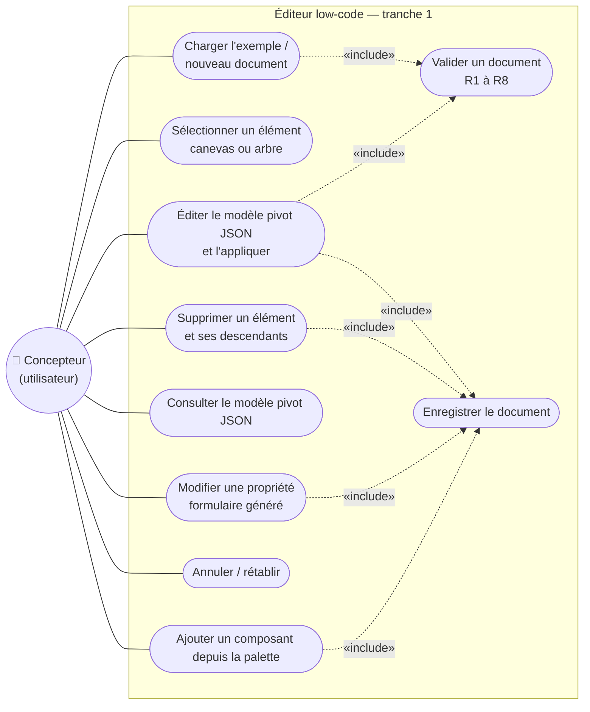

---

## 2. Le style d'architecture : hexagonale (Ports & Adaptateurs)

### 2.1 L'idée

L'**architecture hexagonale** (Alistair Cockburn, 2005), aussi appelée *Ports and Adapters*, sépare :

- **le cœur** (*domaine* + *application*) : les règles du métier, sans aucune technologie ;
- **la périphérie** (*adaptateurs*) : les technologies (React, `localStorage`, `crypto.randomUUID`, plus tard HTTP ou une IA) ;
- **les ports** : des **interfaces définies par le cœur**. Les **ports entrants** décrivent ce que le cœur **offre**, les **ports sortants** ce dont il **a besoin**.

**Règle de dépendance** : les dépendances de code pointent **toujours vers le centre** (adaptateurs → application → domaine), jamais l'inverse.

### 2.2 Diagramme hexagonal (composants)

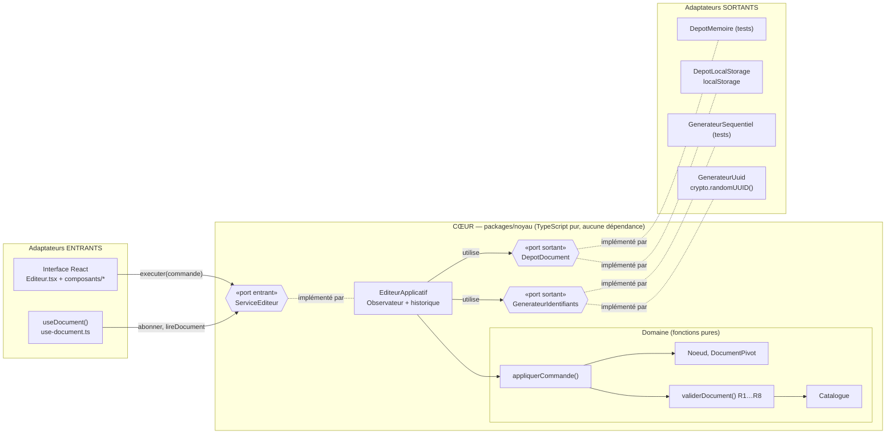

> Lis les flèches pleines comme « appelle / utilise » et les pointillés comme « est implémenté par ». **Attention au sens des dépendances de code** : les adaptateurs sortants (à droite) **importent** les interfaces du cœur pour les implémenter. Ils dépendent donc du cœur, et non l'inverse. **Toutes** les dépendances de code pointent **vers** le cœur. C'est l'**inversion de dépendance** (le « D » de SOLID) : à l'exécution, le cœur appelle le stockage ; à la compilation, c'est le stockage qui dépend du cœur.

### 2.3 Les quatre couches et leurs responsabilités

| Couche | Emplacement | Responsabilité | Peut importer | N'importe jamais |
|---|---|---|---|---|
| **Domaine** | `packages/noyau/src/domaine/` | Métamodèle, catalogue, validation, commandes. **Fonctions pures** (même entrée → même sortie, aucun effet de bord). | Rien d'autre que le domaine | Application, React, DOM, Node |
| **Application** | `packages/noyau/src/application/` | Garder le document courant, appliquer les commandes, enregistrer, notifier, historique | Domaine | React, DOM, Node |
| **Adaptateurs** | `apps/editeur/src/adaptateurs/`, `composants/`, `Editeur.tsx` | Traduire entre le cœur et une technologie | Noyau (API publique **uniquement**), React, DOM | Fichiers internes du noyau |
| **Racine de composition** | `apps/editeur/src/main.tsx` | Choisir les implémentations concrètes, faire les `new`, assembler | Tout | — |

### 2.4 Comment la frontière est **garantie** (et pas seulement promise)

| Protection | Mécanisme | Ce qui se passe si on la viole | Vérifié |
|---|---|---|---|
| 1. pnpm (D4) | Le noyau ne déclare pas React dans son `package.json`. pnpm ne crée donc pas `packages/noyau/node_modules/react` : le module est **introuvable** | `error TS2307: Cannot find module 'react'` | ✅ scénario S9 |
| 2. `"lib": ["ES2022"]` sans `"DOM"`, `"types": []` (D5) | Les types `document`, `window`, `localStorage`, `structuredClone` **n'existent pas** pour le noyau | `error TS2584: Cannot find name 'document'` | ✅ scénario S9 |
| 3. Champ `"exports"` du noyau | Seul `@plateforme/noyau` (→ `src/index.ts`) est importable. `@plateforme/noyau/src/domaine/commandes` est refusé | Erreur de résolution de module | par construction |
| 4. `index.ts` n'exporte pas `appliquerCommande` | L'éditeur **ne peut pas** contourner le service | `has no exported member` | par construction |

---

## 3. Vue des paquetages (monodépôt)

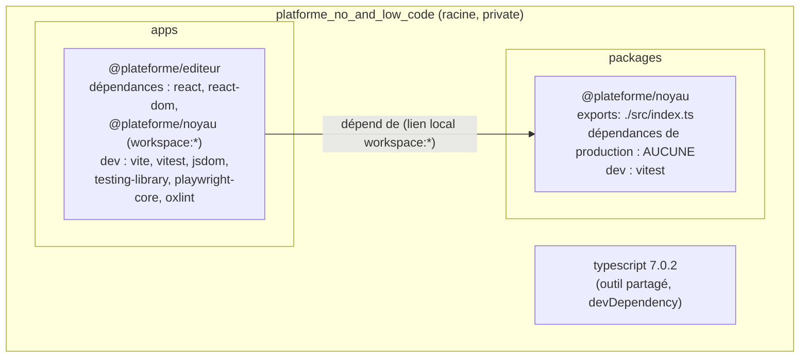

À l'intérieur du noyau :

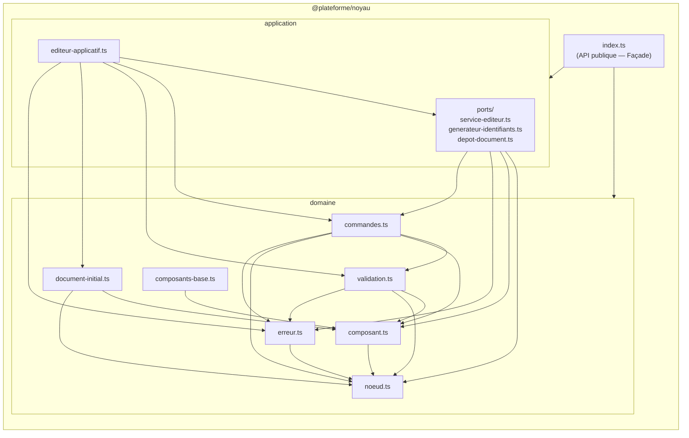

Aucune flèche ne va de `domaine` vers `application` : la règle de dépendance est respectée à l'intérieur du noyau aussi.

---

## 4. Diagrammes de classes

### 4.1 Domaine : le métamodèle et le catalogue

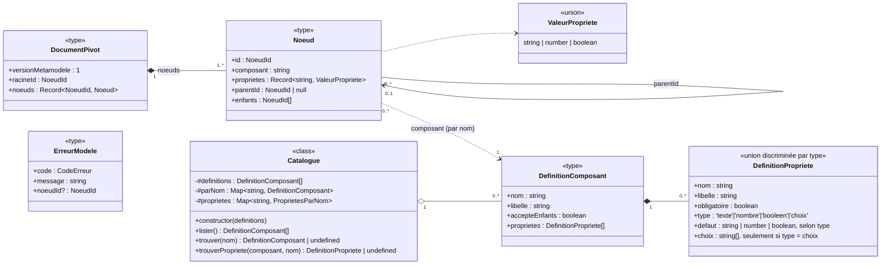

> `ProprietesParNom` désigne `Map<string, DefinitionPropriete>` : le second index du catalogue est une `Map` de `Map` (composant → propriété → définition).
>
> **Subtilité importante** : la relation `Noeud → DefinitionComposant` est une **référence par nom** (`composant: 'Bouton'`), pas un pointeur d'objet. Le document reste du JSON pur et indépendant du catalogue ; c'est la validation (R4, R5, R6) qui vérifie la **conformité** du nœud à sa définition. C'est le patron *Type Object* (voir [phase 1 › 07](../01-phase-1-modele-pivot-et-editeur/07-patrons-de-conception.md)).

### 4.2 Domaine : commandes, événements, résultats

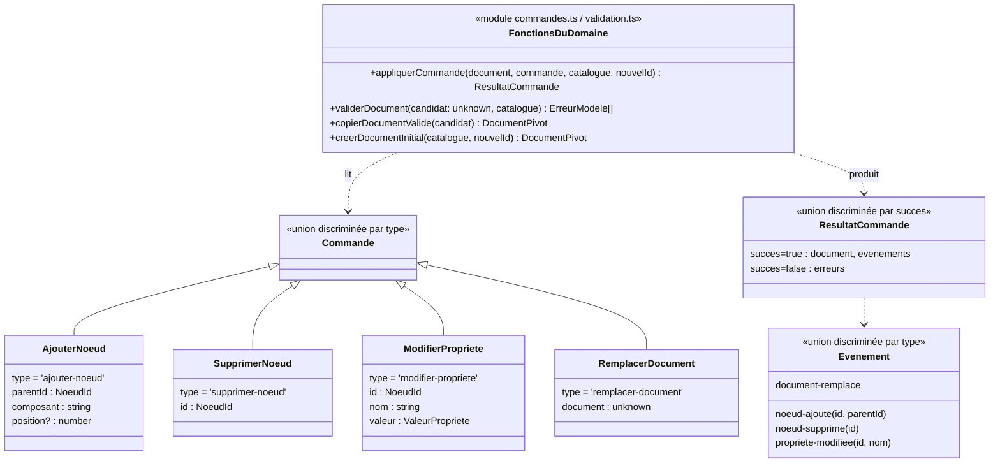

(En TypeScript, ces « sous-classes » ne sont pas des classes. Ce sont les **membres d'un type union**, distingués par le champ `type`. L'héritage du diagramme représente la relation « est un cas de ».)

### 4.3 Application, ports et adaptateurs

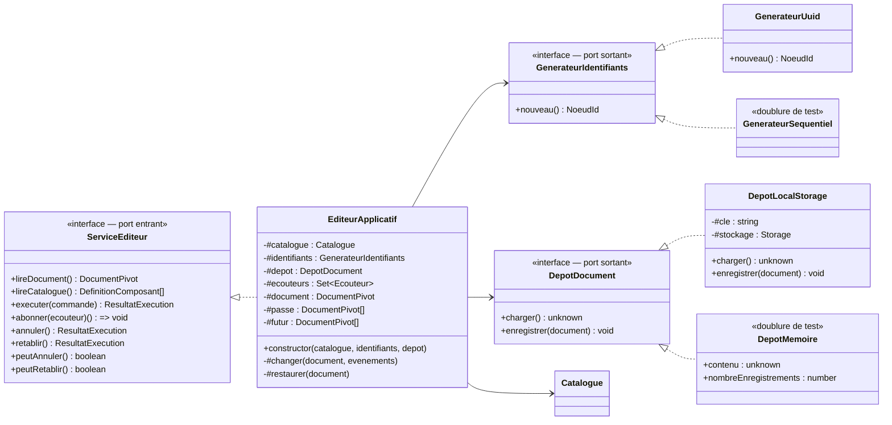

### 4.4 Arbre des composants React (adaptateur entrant)

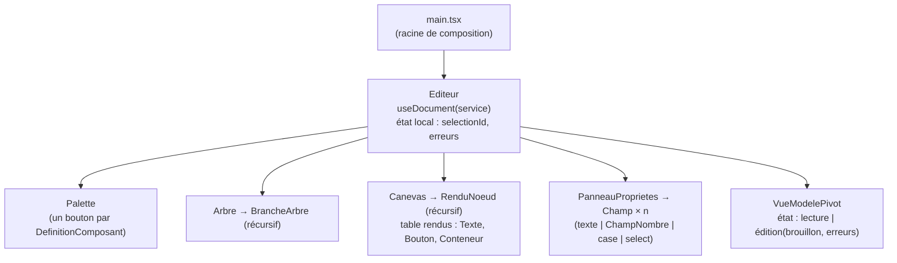

L'état est réparti avec soin :

| Donnée | Où elle vit | Pourquoi |
|---|---|---|
| Le document pivot | **Dans le noyau** (`EditeurApplicatif.#document`), lu par `useDocument` | Source de vérité unique |
| La sélection (`selectionId`) | État React **local** d'`Editeur` | C'est un état **de l'éditeur**, pas de l'application conçue : elle ne doit pas apparaître dans le modèle pivot ni dans l'historique |
| Les messages d'erreur | État React local d'`Editeur` | Idem |
| Le brouillon JSON | État React local de `VueModelePivot` | Il **ne doit pas** suivre le document pendant l'édition |
| Le brouillon d'un champ nombre | État local de `ChampNombre` | Une saisie intermédiaire (`""`, `"-"`) n'est pas un nombre valide |

---

## 5. Diagrammes de séquence

### 5.1 Démarrage de l'application

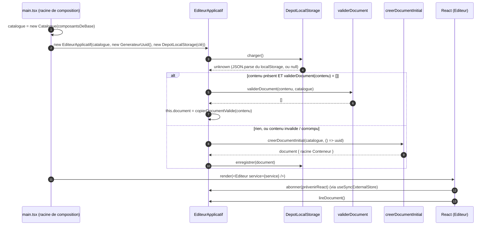

### 5.2 Sens éditeur → modèle : « + Bouton »

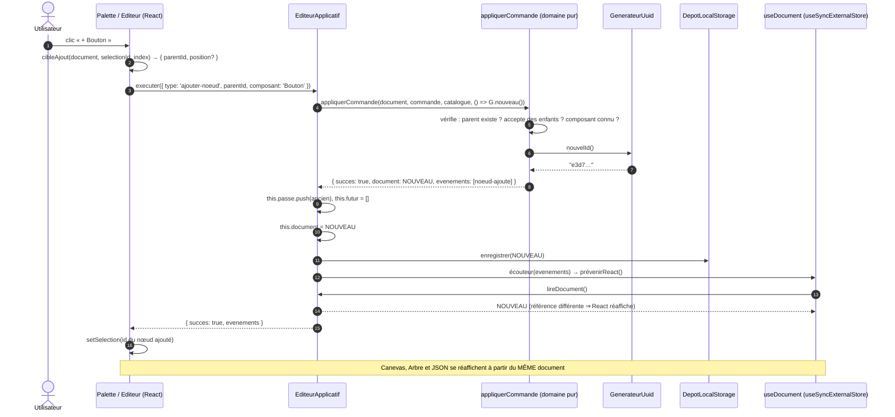

### 5.3 Sens modèle → éditeur : « Appliquer » le JSON

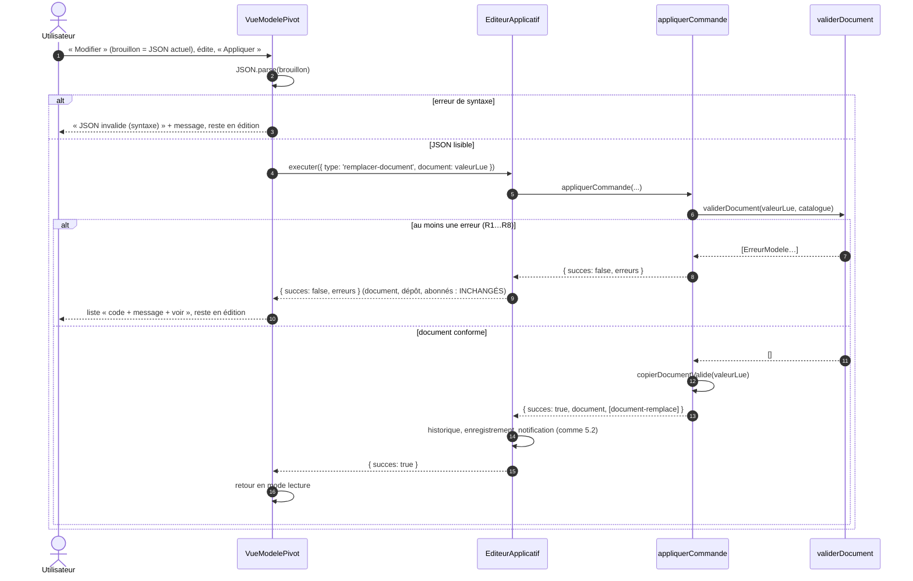

> **Le point clé pour la soutenance** : le canevas ne contient **aucun code spécial** pour le sens modèle → éditeur. Il observe le document. Que le document change à cause d'un clic ou d'un JSON collé, le chemin est **identique** à partir de `executer`.

### 5.4 Annuler (bonus)

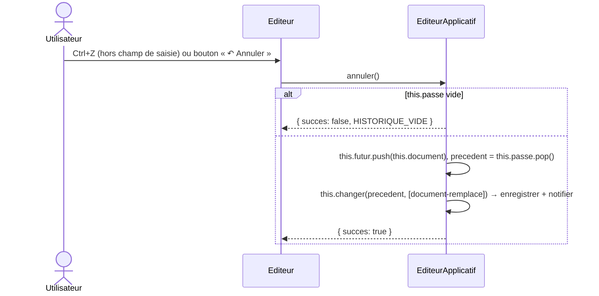

---

## 6. Diagrammes d'états

### 6.1 Le panneau « Modèle pivot (JSON) »

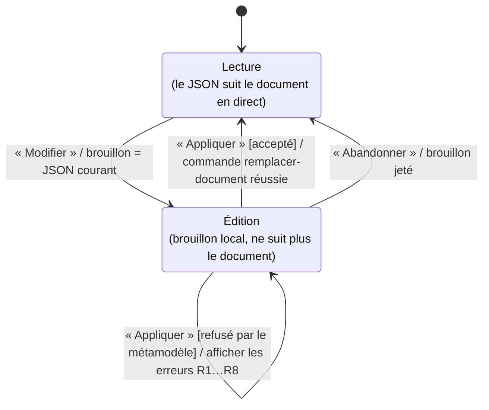

### 6.2 L'historique (annuler / rétablir)

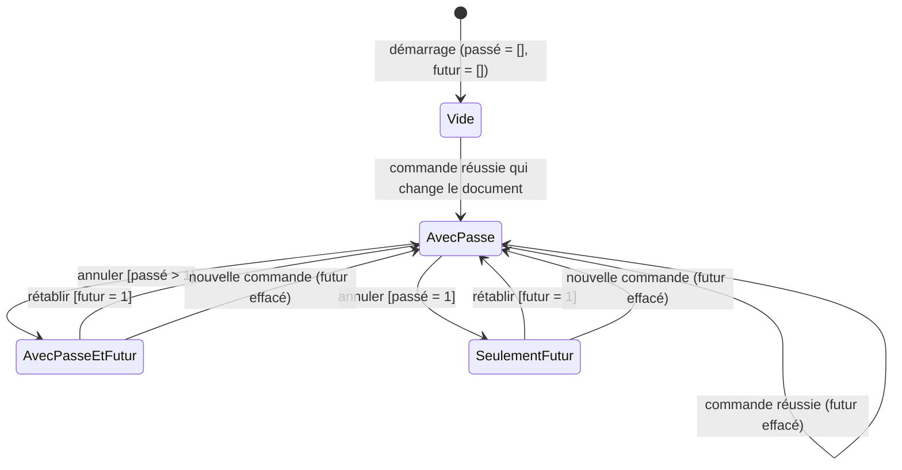

---

## 7. Diagramme d'activité : `validerDocument`

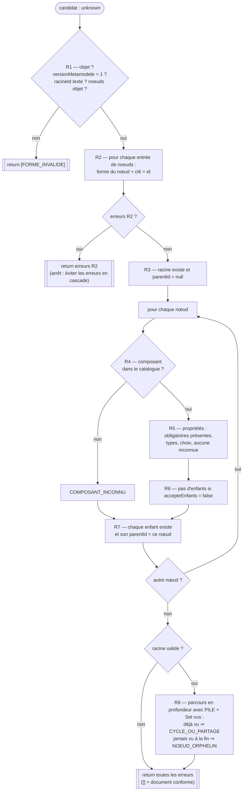

---

## 8. Diagramme de déploiement

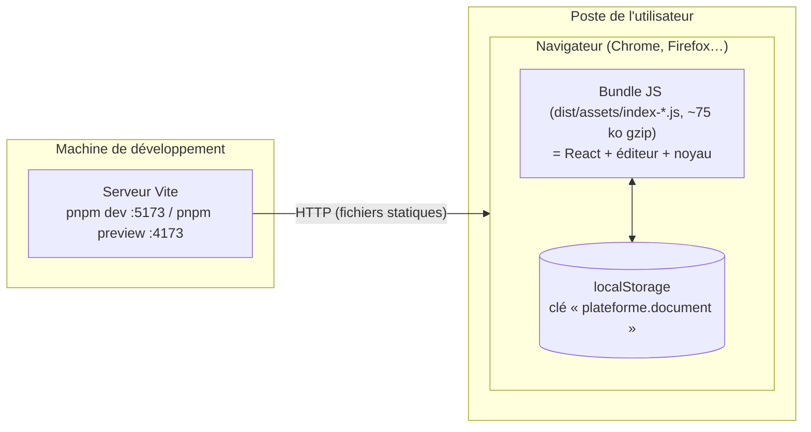

Pour l'instant, il n'y a **aucun serveur applicatif** : tout s'exécute dans le navigateur. Grâce au port `ServiceEditeur`, le noyau pourra plus tard tourner **sur un serveur** sans changer l'interface. Il suffira d'écrire un adaptateur `ServiceEditeurHttp` qui implémente le même port (décision D6).

---

## 9. Diagramme d'objets : le document d'exemple (niveau M1)

Le document de l'étape 2, chargé par le bouton « Charger l'exemple » :

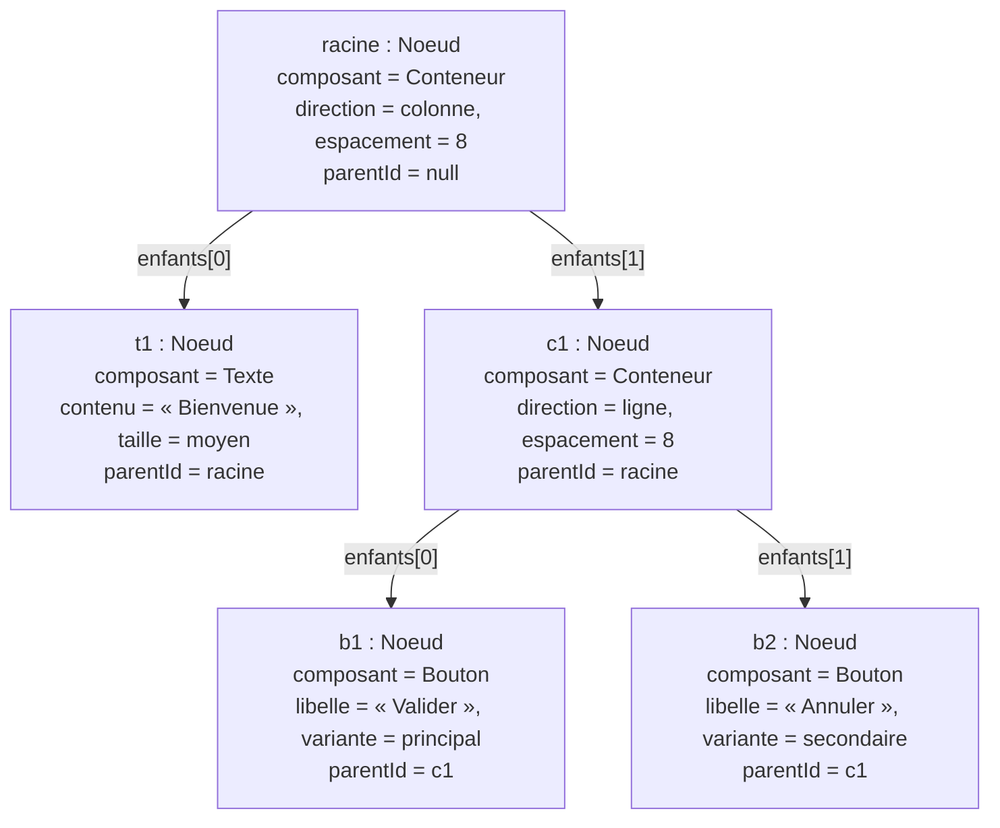

Stockage réel (à plat) : `noeuds = { racine, t1, c1, b1, b2 }`. L'arbre ci-dessus n'est qu'une **lecture** de ces liens `enfants` / `parentId`.

---

## 10. Qualités visées et comment elles sont obtenues

| Qualité | Moyen | Où le vérifier |
|---|---|---|
| **Indépendance technologique du modèle** | Noyau sans React ni DOM, garanti par le compilateur | Scénario S9 |
| **Sûreté** (aucune donnée invalide n'entre) | `validerDocument` sur toute entrée externe (`unknown`), `copierDocumentValide` | `validation.test.ts`, S5 |
| **Prévisibilité** | Fonctions pures, documents immuables, `readonly` partout | « le document d'origine n'a pas changé » dans **chaque** test de commande |
| **Testabilité** | Ports sortants remplacés par des doublures (`n1`, `n2`… ; stockage en mémoire) | `editeur-applicatif.test.ts` |
| **Extensibilité** | Catalogue = données ; palette, formulaire et validation pilotés par le catalogue | Ajouter une entrée dans `composants-base.ts` |
| **Réactivité de l'interface** | Comparaison par référence (immuabilité) + `useSyncExternalStore` | Test « même objet tant que rien ne change » |
| **Robustesse** | `try/catch` sur le stockage, document corrompu ignoré, parcours itératif (pas de débordement de pile) | Tests « dépôt invalide », « 50 000 niveaux » |
