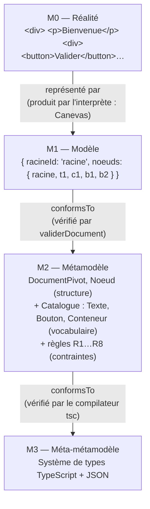
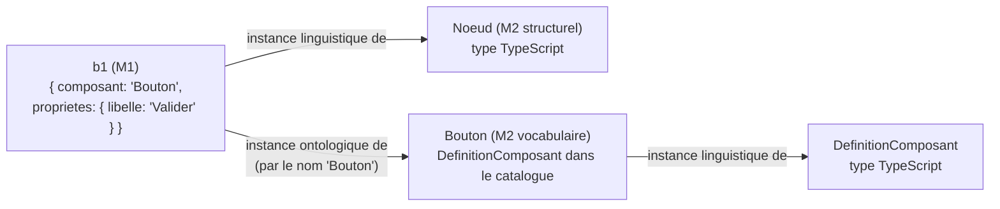

# Le métamodèle actuel : niveaux, conformité et subtilités

> 🟢 **Document de RÉFÉRENCE : il décrit l'état ACTUEL du système.**
> Dernière mise à jour : **29/10/2026, état à la fin de la phase 4**. Il est mis à jour à la fin de chaque phase.
> La version figée de la phase 1 se trouve dans [04-metamodele.md](../01-phase-1-modele-pivot-et-editeur/04-metamodele.md) ; comparer les deux montre l'évolution.

> Ce document explique **ce qu'est un métamodèle**, **où il se trouve dans le code**, et toutes les subtilités qui apparaissent dès qu'on l'implémente. C'est probablement la partie la plus « théorique » de la soutenance : prends le temps de bien la comprendre.

---

## 1. Les définitions de base

| Terme | Définition | Analogie |
|---|---|---|
| **Modèle** | Une représentation simplifiée d'un système, faite dans un but précis | Un plan d'architecte d'**une** maison |
| **Métamodèle** | Le modèle **des modèles** : il définit les concepts autorisés, leurs relations et leurs règles. Un modèle est valide s'il est **conforme** à son métamodèle | La **norme de dessin** des plans : quels symboles existent (mur, porte, fenêtre) et comment ils s'assemblent |
| **Méta-métamodèle** | Le langage dans lequel on écrit les métamodèles | La **grammaire** qui permet d'écrire des normes de dessin |
| **Conformité** (*conformsTo*) | Relation entre un modèle et son métamodèle : le modèle n'utilise que des concepts du métamodèle et en respecte les règles | Un plan qui respecte la norme |
| **Instanciation** (*instanceOf*) | Relation entre un élément et son type | « ce mur » est une instance de « Mur » |
| **Modèle pivot** | Un modèle **central, indépendant de toute technologie**, dont on dérive tout le reste (rendu, code React, code Vue…). On n'écrit qu'**un** traducteur par cible, au lieu d'un traducteur par **paire** de technologies | La langue pivot d'un traducteur (traduire le japonais → anglais → portugais) |

---

## 2. L'architecture à quatre niveaux (OMG / MOF)

L'OMG (*Object Management Group*) organise l'ingénierie dirigée par les modèles (IDM, en anglais MDE : *Model-Driven Engineering*) en **quatre niveaux**. Chaque niveau est **conforme** au niveau supérieur :

| Niveau | Nom | Dans le monde UML | **Dans notre projet** | Fichier |
|---|---|---|---|---|
| **M3** | Méta-métamodèle | MOF (*Meta-Object Facility*) | **Le système de types de TypeScript** (et JSON pour les valeurs). C'est le langage dans lequel on **écrit** le métamodèle | — (le langage lui-même) |
| **M2** | Métamodèle | La spécification UML (Classe, Attribut, Association…) | **(a)** Les types `DocumentPivot`, `Noeud`, `ValeurPropriete`<br/>**(b)** Les types `DefinitionComposant` et `DefinitionPropriete`, et le catalogue `composantsDeBase` (Texte, Bouton, Conteneur)<br/>**(c)** Les règles de bonne formation R1 à R8 | `domaine/noeud.ts`<br/>`domaine/composant.ts`, `composants-base.ts`<br/>`domaine/validation.ts` |
| **M1** | Modèle | Un diagramme de classes d'un projet | **Un document pivot concret** : « une racine Conteneur avec un Texte Bienvenue et deux Boutons » | Le JSON affiché à droite de l'éditeur, `test/exemple.ts` |
| **M0** | Système réel | Les objets en mémoire à l'exécution | **L'interface réellement affichée** : les `<p>`, `<button>` et `<div>` du canevas (et, plus tard, l'application générée) | Ce que tu vois dans le canevas |



> **À dire à l'oral** : « Chaque niveau a son vérificateur. Le **compilateur TypeScript** vérifie que le métamodèle (M2) est bien écrit dans le langage M3. **`validerDocument`** vérifie qu'un modèle (M1) est conforme au métamodèle (M2). Le **canevas** fabrique le niveau M0 à partir du M1. »

---

## 3. La subtilité centrale : un métamodèle en **deux parties**

En implémentant, on découvre que le niveau M2 est fait de **deux couches** :

### 3.1 La partie **structurelle** (fixe, dans le code TypeScript)

`noeud.ts` définit **la forme de tout document**, quel que soit le composant :

```ts
type Noeud = { id; composant: string; proprietes: Record<string, ValeurPropriete>; parentId; enfants };
type DocumentPivot = { versionMetamodele: 1; racineId; noeuds: Record<NoeudId, Noeud> };
```

Elle ne parle **pas** de « Bouton » : pour elle, un nœud est un nœud.

### 3.2 La partie **vocabulaire** (des données, dans le catalogue)

`composants-base.ts` définit **quels composants existent** et quelles propriétés ils ont :

```ts
{ nom: 'Bouton', accepteEnfants: false, proprietes: [
    { nom: 'libelle', type: 'texte', defaut: 'Bouton', obligatoire: true },
    { nom: 'variante', type: 'choix', choix: ['principal', 'secondaire'], defaut: 'principal', … },
    { nom: 'desactive', type: 'booleen', defaut: false, … } ] }
```

Ce sont des **données**, pas des types TypeScript. Le compilateur ne sait pas qu'un Bouton a un libellé : **c'est la validation qui le vérifie, à l'exécution**.

**État actuel du vocabulaire** (après la phase 2) :

| Composant | Propriétés |
|---|---|
| **Texte** | `contenu` (obligatoire), `taille`, `couleur`, `gras`, `alignementTexte`, `marge` |
| **Bouton** | `libelle` (obligatoire), `variante`, `couleur`, `pleineLargeur`, `desactive`, `marge` |
| **Conteneur** | `direction`, `espacement`, `alignement`, `justification`, `margeInterne`, `fond`, `bordure`, `arrondi`, `marge` |

Les couleurs sont des **noms** d'une palette fixe (`primaire`, `secondaire`, `succes`, `danger`, `neutre`, `gris`, `clair`, `blanc`). Le modèle ne contient jamais de valeur CSS (D36).

**Démonstration du principe** : la phase 2 a ajouté 14 propriétés **sans changer la structure** ni `versionMetamodele`. Les documents de la phase 1 restent valides, et une propriété absente prend la valeur par défaut du catalogue (D37, D40).

### 3.3 Typage linguistique et typage ontologique

Cette séparation porte un nom dans la recherche (Atkinson & Kühne, *Model-Driven Development: A Metamodeling Foundation*, IEEE Software, 2003). Un nœud a **deux types en même temps** :

| | **Type linguistique** | **Type ontologique** |
|---|---|---|
| Question | « De quoi ce nœud est-il **fait** ? » | « Que **représente**-t-il dans le domaine ? » |
| Pour le nœud `b1` | `Noeud` (le type TypeScript) | `Bouton` (une entrée du catalogue) |
| Où c'est défini | `noeud.ts` (partie structurelle) | `composants-base.ts` (partie vocabulaire) |
| Qui le vérifie | le compilateur + R1, R2, R3, R7, R8 | R4, R5, R6 |
| Comment on l'étend | en **changeant le code** (et `versionMetamodele`) | en **ajoutant une donnée** au catalogue |



**Pourquoi c'est un bon choix** (à argumenter) :
- ajouter un composant (Image, Champ de saisie…) **ne demande pas de modifier le métamodèle structurel**, ni la palette, ni le panneau de propriétés, ni la validation. Il suffit d'ajouter **une entrée de données** ;
- c'est **la graine du système de plugins** : un plugin pourra fournir ses propres `DefinitionComposant` ;
- c'est ainsi que fonctionnent les outils réels : GrapesJS (*component types*), Craft.js (*resolver*), Builder.io (*registered components*).

**La contrepartie** : la vérification du vocabulaire se fait **à l'exécution** (validation), pas à la compilation. C'est pourquoi la validation doit être **complète** et pourquoi chaque commande est testée avec « le résultat est valide ».

> Dans la littérature, ce montage s'appelle aussi le patron **Type Object** (Johnson & Woolf, 1997) : au lieu de créer une sous-classe par sorte d'objet (`class Bouton extends Noeud`), on crée **un objet qui décrit le type** (`DefinitionComposant`), et chaque instance **référence** son type (`composant: 'Bouton'`).

---

## 4. Les règles de bonne formation (les « contraintes » du métamodèle)

Un métamodèle, ce n'est pas seulement une structure : ce sont aussi des **contraintes** qu'un diagramme de classes ne sait pas exprimer. En UML, on les écrirait en **OCL** (*Object Constraint Language*). Ici, elles sont écrites en TypeScript dans `validerDocument`.

| N° | Règle | Nature | Équivalent OCL (pour le mémoire) |
|---|---|---|---|
| R1 | Le document est un objet `{ versionMetamodele: 1, racineId: texte, noeuds: objet }` | Structurelle (forme) | `self.versionMetamodele = 1` |
| R2 | Chaque nœud a la bonne forme et `clé = id` | Structurelle (forme) | `self.noeuds->forAll(k, n \| n.id = k)` |
| R3 | La racine existe et n'a pas de parent | Structurelle (arbre) | `self.noeuds->includesKey(self.racineId) and racine.parentId->isEmpty()` |
| R4 | Le composant de chaque nœud existe dans le catalogue | **Ontologique** | `Catalogue.allInstances()->exists(d \| d.nom = self.composant)` |
| R5 | Propriétés : obligatoires présentes, bon type, choix permis, aucune inconnue | **Ontologique** | `def.proprietes->select(obligatoire)->forAll(p \| self.proprietes->includesKey(p.nom))` |
| R6 | Un composant sans enfants n'a pas d'enfants | **Ontologique** | `not def.accepteEnfants implies self.enfants->isEmpty()` |
| R7 | Chaque enfant existe et pointe vers son parent | Structurelle (cohérence de la double liaison) | `self.enfants->forAll(e \| e.parentId = self.id)` |
| R8 | Chaque nœud est atteignable depuis la racine **exactement une fois** | Structurelle (c'est un **arbre**) | pas d'orphelin, pas de cycle, pas de partage |

### Subtilités des règles

1. **Pourquoi R8 est nécessaire alors que R7 existe ?** R7 vérifie les liens **localement**, nœud par nœud. Mais un ensemble de liens localement corrects peut former un **cycle isolé** : `a.enfants=[b], b.parentId=a, b.enfants=[a], a.parentId=b`. Chaque lien est « cohérent », pourtant ce n'est pas un arbre et ces nœuds ne sont pas reliés à la racine. Seul un **parcours global** (R8) le détecte.
2. **Pourquoi s'arrêter après R1 et R2 ?** Si la forme est fausse, les règles suivantes liraient des champs absents. Après R1, elles planteraient. Après R2, elles produiraient des **erreurs en cascade** trompeuses : un nœud mal formé ferait apparaître tous ses voisins comme « incohérents ». Après R3, en revanche, on continue : R4 à R7 restent utiles même sans racine valide. Seul R8 a besoin de la racine (voir D16).
3. **« Obligatoire » veut dire « présent », pas « non vide ».** Un libellé `""` est accepté. Sinon, quand l'utilisateur efface tout le champ pour retaper un texte, la commande serait refusée et le champ « résisterait » à la saisie (voir D20).
4. **Un nombre doit être fini.** `NaN` et `Infinity` sont refusés, car `JSON.stringify(NaN)` donne `null`. Le document deviendrait invalide après un simple aller-retour par le stockage. C'est une contrainte imposée par le **format de sérialisation** (M3 = JSON) au métamodèle (M2).
   **Bornes** *(phase 2)* : `DefinitionPropriete` de type `nombre` accepte `min` et `max` : une marge ou un arrondi ne peuvent pas être négatifs. C'est la seule évolution du **type** `DefinitionPropriete` depuis la phase 1 (D38). Elle enrichit le langage qui décrit le vocabulaire, pas la structure des documents.
5. **`parentId: null` et non un champ absent.** JSON ne connaît pas `undefined` : `JSON.stringify({ a: undefined })` donne `"{}"`. Avec `null`, la racine reste **explicitement** sans parent après sérialisation.
6. **Les clés héritées de JavaScript.** Un objet JS hérite de `toString`, `constructor`, `__proto__`… Un document dont `racineId` vaut `"toString"` passerait un test naïf `noeuds[racineId] !== undefined`. Toute recherche passe donc par `Object.hasOwn` (fonction `trouverNoeud`), ou par des `Map` construites à partir des entrées. C'est testé.

---

## 5. Conformité dans les deux sens : qui garantit quoi ?

| Source du document | Garantie | Mécanisme |
|---|---|---|
| Une **commande** (palette, panneau, suppression) | Le résultat est conforme **par construction** : chaque commande vérifie ses préconditions et maintient les invariants (double liaison, arbre) | Code de `commandes.ts`. **Prouvé par les tests** : chaque test de commande revalide le document produit (`validerDocument(resultat) = []`) |
| Le **JSON édité à la main** | Conforme **par vérification** : refusé s'il y a la moindre erreur | `remplacer-document` → `validerDocument` |
| Le **stockage** (`localStorage`) au démarrage | Conforme par vérification ; sinon on repart d'un document neuf | Constructeur d'`EditeurApplicatif` |

> Le principe : **les invariants du métamodèle sont maintenus en permanence**. Le document détenu par le service est **toujours** conforme. Aucun état intermédiaire invalide n'est jamais visible.

---

## 6. La double liaison `parentId` / `enfants` : une redondance voulue

Le métamodèle stocke le lien parent → enfant **deux fois** : dans `parent.enfants` et dans `enfant.parentId`.

| Avantage | Inconvénient |
|---|---|
| Descendre (enfants d'un nœud) : O(1) | Les deux informations peuvent **se contredire** |
| Remonter (parent d'un nœud) : O(1). Sans `parentId`, il faudrait parcourir tout le document : O(n) | Chaque commande doit mettre à jour **les deux** côtés |
| `enfants` donne aussi **l'ordre** d'affichage | |

**Qui garantit la cohérence ?** Les commandes la maintiennent, et la règle R7 la vérifie pour tout ce qui vient de l'extérieur. C'est un compromis classique entre **normalisation** (une seule source pour chaque fait) et **performance d'accès**.

---

## 7. Le versionnement du métamodèle

Le champ `versionMetamodele` est typé par le **littéral** `1`, et non par `number`.

- Le compilateur refuse `versionMetamodele: 2` dans le code ;
- R1 refuse tout document dont la version n'est pas `1`.

**Pourquoi ?** Le jour où la forme changera (ajout des pages, des données, de la logique), on passera à `2`. On écrira alors une **migration** `1 → 2`, c'est-à-dire une transformation de modèle M2M (*model-to-model*). Les anciens documents enregistrés seront reconnus grâce à leur numéro et convertis, au lieu d'être rejetés en silence ou mal interprétés.

---

## 7 bis. Le métamodèle au format standard : JSON Schema *(phase 3)*

Le catalogue (notre format maison) est **traduit automatiquement** en un **JSON Schema** standard (*draft 2020-12*) : `packages/schema-json/schema/document-pivot.v1.schema.json`, téléchargeable depuis l'éditeur.

| Règle | Où elle est vérifiée |
|---|---|
| Forme (R1, R2), composant connu (R4), propriétés (R5), enfants interdits (R6) | **JSON Schema** et noyau |
| Clé = id, racine existante (R3), liens cohérents (R7), arbre sans cycle (R8) | **Noyau seulement** : contraintes **référentielles** et **globales**, que JSON Schema ne sait pas exprimer |

La validation se fait donc en **deux couches**. Leur cohérence est vérifiée sur 1 000 documents aléatoires, sans aucune contradiction. Une différence est **voulue** : un champ structurel en trop est refusé par le schéma (forme canonique) mais toléré, puis retiré, par le noyau (principe de robustesse). Théorie complète : [phase 3 › 03](../03-phase-3-deplacement-et-json-schema/03-json-schema-et-ses-limites.md).

---

## 7 ter. Deux formes pour le même modèle : à plat et imbriqué *(phase 4)*

Le **même** document M1 peut s'écrire de deux façons. Ce sont deux **sérialisations** du même métamodèle (même `versionMetamodele: 1`), pas deux métamodèles.

| | **À plat** (format interne, D8) | **Imbriqué** (format d'échange, D71) |
|---|---|---|
| Lien parent → enfant | Une **référence** : identifiant dans `enfants`, `parentId` | La **position** : l'enfant est écrit dans son parent |
| Champs propres | `racineId`, `noeuds: { id → nœud }`, `parentId` | `format: "pivot-imbrique"`, `racine`, `enfants` (nœuds) |
| Identifiants | Obligatoires | **Facultatifs** ; fabriqués `n1`, `n2`… à l'import (D72) |
| Sert à | Éditer : O(1), modifications locales, historique, glisser-déposer | Échanger : humains, outils, IA |
| Règles non exprimables en JSON Schema | Clé = id, R3, R7, R8 | **Seulement** l'unicité des `id` (et aucune s'ils sont omis) |
| Schéma publié | `document-pivot.v1.schema.json` | `document-imbrique.v1.schema.json` (récursif) |

Conversions : `versImbrique` et `depuisImbrique` (`@plateforme/format-imbrique`), toutes deux itératives et en O(n). L'import se termine **toujours** par la validation complète du noyau (R1 à R8). L'aller-retour est exact (prouvé par tests par propriétés). Théorie complète : [phase 4 › 02](../04-phase-4-format-d-echange-imbrique/02-conception-et-theorie.md).

---

## 8. Du modèle à la réalité : interpréter ou générer

Le niveau M0 peut être produit de deux façons :

| | **Interprétation** (le canevas) | **Génération** (les générateurs, phase 2) |
|---|---|---|
| Principe | Parcourir le modèle et **afficher directement** | Parcourir le modèle et **écrire du code** (React, Vue) |
| Où | `Canevas.tsx` affiche l'arbre web | `generateur-react`, `generateur-vue` écrivent l'arbre web en JSX ou en template |
| Point commun | **Les mêmes règles** : `rendu-web` traduit le modèle (M1), avec l'aide du catalogue (M2), en un arbre web commun | idem |

Depuis la phase 2, interprétation et génération partagent **la même** étape modèle → web. Ce que l'on voit est donc, **par construction**, ce que l'on exporte. C'est mesuré par la recette de parité. Théorie complète (PIM, PSM, M2M, M2T) : [phase 2 › 03](../02-phase-2-generateurs-react-vue/03-transformation-modele-vers-code.md).

---

## 9. Ce que le métamodèle ne sait pas (encore) exprimer

À dire honnêtement si on te le demande :

- **une seule page** : pas de navigation ni de liste de pages ;
- **pas de données ni de logique** : pas de variables, d'événements (« au clic, faire… ») ni de liaison à une API ;
- **le style est limité** aux propriétés déclarées et à une palette fixe (pas de CSS libre, pas encore de thèmes modifiables) ;
- **les définitions de composants sont en dur** dans `composants-base.ts`, pas encore chargées comme plugins ;
- **une partie des règles (R3, R7, R8, clé = id) n'existe que dans le noyau** : JSON Schema ne peut pas les exprimer (§7 bis). Un autre outil qui n'utilise que le schéma peut donc accepter un document mal relié.

Ce sont des **limites de périmètre**, pas des défauts de conception : le versionnement (§7) et la séparation structure / vocabulaire (§3) sont faits pour accueillir ces extensions.

---

## 10. Lectures pour approfondir (citables dans le mémoire)

- **OMG, *Meta Object Facility (MOF) Core Specification***, version 2.5.1 : les niveaux M0 à M3.
- **Atkinson C., Kühne T. (2003)**, *Model-Driven Development: A Metamodeling Foundation*, IEEE Software 20(5) : métamodélisation linguistique et ontologique.
- **Bézivin J. (2005)**, *On the unification power of models*, Software & Systems Modeling 4(2) : les relations *conformsTo* et *representationOf*.
- **Johnson R., Woolf B. (1997)**, *Type Object*, dans *Pattern Languages of Program Design 3* : le patron Type Object.
- **OMG, *Object Constraint Language (OCL)***, version 2.4 : exprimer des contraintes comme R1 à R8.
- **Kleppe A., Warmer J., Bast W. (2003)**, *MDA Explained* : PIM, PSM, transformations.
