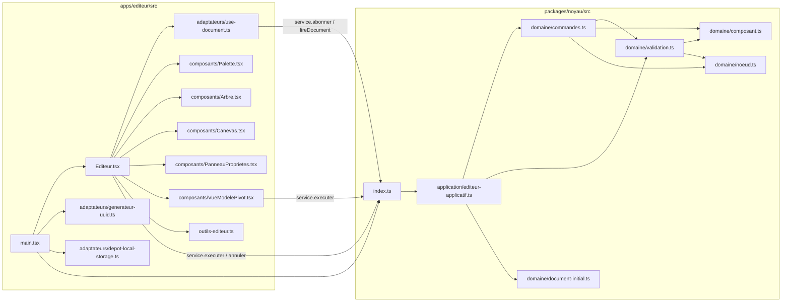

# Fonctionnement des fonctionnalités, de l'écran jusqu'au code

> 🟢 **Document de RÉFÉRENCE : il décrit l'état ACTUEL du système.**
> Dernière mise à jour : **21/10/2026, état à la fin de la phase 1**.
>
> Pour **chaque fonctionnalité** :
> 1. **ce que voit l'utilisateur** ;
> 2. **le chemin** à travers les fichiers ;
> 3. **le code**, extrait et commenté ;
> 4. **les cas limites** et les protections ;
> 5. **les tests** qui le prouvent.
>
> Les chemins de fichiers sont relatifs à la racine du dépôt. Garde le code ouvert à côté.

## Sommaire

| N° | Fonctionnalité | Sens |
|---|---|---|
| [F0](#f0--la-carte--quel-fichier-appelle-quel-fichier) | La carte : quel fichier appelle quel fichier | — |
| [F1](#f1--démarrage-de-lapplication) | Démarrage de l'application | — |
| [F2](#f2--affichage-synchronisé-canevas-arbre-json) | Affichage synchronisé (canevas, arbre, JSON) | modèle → écran |
| [F3](#f3--le-rendu-du-canevas-linterprète) | Le rendu du canevas (l'interprète) | modèle → écran |
| [F4](#f4--la-sélection) | La sélection | état de l'éditeur |
| [F5](#f5--ajouter-un-composant-depuis-la-palette) | Ajouter un composant depuis la palette | éditeur → modèle |
| [F6](#f6--modifier-une-propriété-formulaire-généré) | Modifier une propriété (formulaire généré) | éditeur → modèle |
| [F7](#f7--supprimer-un-élément) | Supprimer un élément | éditeur → modèle |
| [F8](#f8--éditer-le-modèle-pivot-en-json) | Éditer le modèle pivot en JSON | modèle → éditeur |
| [F9](#f9--la-validation-le-garde-fou) | La validation (le garde-fou) | — |
| [F10](#f10--la-persistance) | La persistance | — |
| [F11](#f11--annuler--rétablir) | Annuler / rétablir | — |
| [F12](#f12--charger-lexemple--nouveau-document) | Charger l'exemple / nouveau document | — |

---

## F0 — La carte : quel fichier appelle quel fichier



**À retenir** : l'éditeur ne parle au noyau que par `index.ts`, et en pratique seulement par l'objet `service` (le port `ServiceEditeur`). Aucun fichier de l'éditeur n'importe `commandes.ts` ou `validation.ts` directement.

---

## F1 — Démarrage de l'application

**Ce que voit l'utilisateur** : la page s'ouvre. Il retrouve son dernier document ou, la première fois, une racine vide.

**Chemin** : `index.html` → `main.tsx` → `new EditeurApplicatif(...)` → `DepotLocalStorage.charger()` → `validerDocument()` → React monte `<Editeur>`.

**Le code**, dans `apps/editeur/src/main.tsx` :

```ts
const catalogue = new Catalogue(composantsDeBase);                    // 1. le vocabulaire (Texte, Bouton, Conteneur)
const service = new EditeurApplicatif(                                // 2. le cœur, avec SES adaptateurs :
  catalogue,
  new GenerateurUuid(),                                               //    les identifiants viendront de crypto.randomUUID()
  new DepotLocalStorage(CLE_STOCKAGE),                                //    le stockage sera le localStorage
);
createRoot(racine).render(<StrictMode><Editeur service={service} /></StrictMode>);  // 3. l'interface reçoit le service
```

Puis dans le constructeur, `packages/noyau/src/application/editeur-applicatif.ts` :

```ts
const charge = depot.charger();                                       // unknown : on ne sait PAS ce qu'il y a dedans
if (charge !== null && validerDocument(charge, catalogue).length === 0) {
  this.#document = copierDocumentValide(charge);                      // valide → on le reprend (copie propre)
} else {
  this.#document = creerDocumentInitial(catalogue, () => identifiants.nouveau());  // sinon document neuf
  depot.enregistrer(this.#document);                                  // enregistré tout de suite (D25)
}
```

**Cas limites** :

| Situation | Ce qui se passe |
|---|---|
| Premier lancement (rien dans le stockage) | `charger()` renvoie `null` et on crée un document neuf |
| Stockage corrompu (JSON cassé) | `DepotLocalStorage.charger()` attrape l'erreur de `JSON.parse` et renvoie `null`, donc on crée un document neuf |
| Stockage lisible mais **invalide** (modifié à la main, ancienne version) | `validerDocument` renvoie des erreurs, donc on crée un document neuf. **L'application ne plante jamais au démarrage** |
| Stockage bloqué par le navigateur | Exception attrapée, comme pour un stockage corrompu |

**Tests** : `editeur-applicatif.test.ts` (« démarrage » : dépôt vide, valide, invalide) ; `depot-local-storage.test.ts` ; `Editeur.test.tsx` (« document corrompu ignoré au démarrage »).

---

## F2 — Affichage synchronisé (canevas, arbre, JSON)

**Ce que voit l'utilisateur** : le canevas, l'arbre et le JSON montrent **toujours** la même chose. Quand l'un change, tous changent.

**Le principe** : ils ne se parlent **pas** entre eux. Ils lisent tous **le même objet** `document`, fourni par un seul hook.

**Le code**, dans `apps/editeur/src/adaptateurs/use-document.ts` :

```ts
export function useDocument(service: ServiceEditeur): DocumentPivot {
  const abonner = useCallback(
    (prevenirReact: () => void) => service.abonner(() => prevenirReact()),  // (a)
    [service],
  );
  return useSyncExternalStore(abonner, () => service.lireDocument());     // (b)
}
```

- **(a)** `useSyncExternalStore` donne à React une fonction `prevenirReact`. On l'enregistre comme **écouteur** du service (patron Observateur). `service.abonner` renvoie la fonction de désabonnement, que React appellera quand le composant disparaîtra.
- **(b)** À chaque notification, React rappelle `lireDocument()` et **compare le résultat au précédent avec `Object.is`**, c'est-à-dire **par référence**. Si la référence est différente, il réaffiche.

**Pourquoi ça marche** : le document est **immuable** (D7). Une commande réussie crée un **nouvel** objet ; une commande refusée ou sans effet ne change rien. La référence change donc **si et seulement si** le contenu a changé. Si on modifiait l'objet sur place, React recevrait **le même** objet et **n'afficherait rien**.

Dans `Editeur.tsx`, le même `document` est ensuite passé aux trois vues :

```tsx
const document = useDocument(service);
<Arbre document={document} … />
<Canevas document={document} … />
<VueModelePivot document={document} … />     // affiche JSON.stringify(document, null, 2)
```

**Tests** : « lireDocument renvoie le MÊME objet tant que rien ne change, un AUTRE après » (`editeur-applicatif.test.ts`) ; « le canevas, l'arbre et le JSON montrent le même document » (`Editeur.test.tsx`).

---

## F3 — Le rendu du canevas (l'interprète)

**Ce que voit l'utilisateur** : l'interface conçue (`<p>`, `<button>`, conteneurs en flex), cliquable.

**Le code**, dans `apps/editeur/src/composants/Canevas.tsx`. Un composant **récursif** parcourt l'arbre depuis la racine :

```tsx
function RenduNoeud({ document, id, selectionId, onSelectionner }) {
  const noeud = trouverNoeud(document, id);              // accès O(1) dans la table à plat
  if (noeud === undefined) return null;
  const attributs = {
    'data-noeud-id': id,                                 // permet aux tests de retrouver l'élément
    className: `apercu${id === selectionId ? ' selectionne' : ''}`,
    onClick: (e) => { e.stopPropagation(); onSelectionner(id); },
  };
  const enfants = noeud.enfants.map((enfantId) =>        // récursion : chaque enfant, DANS L'ORDRE
    <RenduNoeud key={enfantId} document={document} id={enfantId} … />);
  const rendu = rendus[noeud.composant];                 // patron Stratégie : table composant → rendu
  if (rendu === undefined) return <div …>Composant inconnu : {noeud.composant}</div>;
  return rendu({ noeud, enfants, attributs });
}
```

La table `rendus` traduit chaque composant en HTML :

| Composant | Rendu | Propriétés utilisées |
|---|---|---|
| `Texte` | `<p>` | `contenu` ; `taille` → `font-size` (0,85 / 1 / 1,6 rem) |
| `Bouton` | `<button>` | `libelle` ; `variante` → classe CSS ; `desactive` → `aria-disabled` + style atténué |
| `Conteneur` | `<div>` en `display: flex` | `direction` → `flex-direction: column / row` ; `espacement` → `gap` en px ; les enfants à l'intérieur |

**Détails importants** :
- `key={enfantId}` : React identifie chaque enfant par son **identifiant stable**. Quand on insère un nœud au milieu, React ne recrée pas les autres.
- `e.stopPropagation()` : sans lui, un clic sur un Bouton **remonterait** jusqu'au Conteneur parent, puis jusqu'à la racine, et la sélection finirait toujours sur la racine.
- Le clic sur le **fond** du canevas (`<div className="canevas" onClick={() => onSelectionner(null)}>`) désélectionne.
- Pas d'attribut HTML `disabled` sur les boutons : un bouton `disabled` ne reçoit plus les clics, on ne pourrait plus le sélectionner (D29).

**Tests** : « un conteneur en ligne est rendu en flex « row » » ; les scénarios S1 à S4 vérifient le texte affiché dans le canevas.

---

## F4 — La sélection

**Ce que voit l'utilisateur** : un contour bleu sur l'élément choisi (canevas) et une ligne surlignée (arbre). Le panneau de propriétés affiche cet élément.

**Où vit la sélection** : **pas** dans le modèle pivot, mais dans un `useState` d'`Editeur.tsx` (D27). Elle décrit ce que fait **l'utilisateur de l'éditeur**, pas l'application conçue.

```tsx
const [selectionBrute, setSelection] = useState<NoeudId | null>(null);
// Sélection DÉRIVÉE : si le nœud n'existe plus (supprimé, annulé, JSON remplacé), elle vaut null.
const selectionId = selectionBrute !== null && trouverNoeud(document, selectionBrute) ? selectionBrute : null;
```

**Pourquoi « dérivée »** : plutôt que de surveiller chaque suppression avec un `useEffect`, on **recalcule** à chaque affichage si la sélection est encore valable. On a une seule source de vérité (le document) et aucun état incohérent possible.

**Synchronisation arbre ↔ canevas** : les deux reçoivent la même `selectionId` et la même fonction `setSelection`. Cliquer dans l'un met à jour l'état d'`Editeur`, et les deux se réaffichent.

**Tests** : « l'arbre et le canevas partagent la sélection ».

---

## F5 — Ajouter un composant depuis la palette

**Ce que voit l'utilisateur** : il clique sur « + Bouton ». Le bouton apparaît au bon endroit, il est sélectionné, et le JSON contient un nouveau nœud.

**Chemin** : `Palette.tsx` → `Editeur.ajouter` → `cibleAjout` (où ?) → `service.executer` → `appliquerCommande` → `ajouterNoeud` → nouveau document → notification → réaffichage → sélection du nouveau nœud.

**1. La palette** (`composants/Palette.tsx`) ne connaît aucun composant en dur :
```tsx
{definitions.map((d) => <button key={d.nom} onClick={() => onAjouter(d.nom)}>+ {d.libelle}</button>)}
```

**2. Où insérer ?** (`outils-editeur.ts` → `cibleAjout`, fonction pure) :

| Sélection actuelle | Résultat |
|---|---|
| aucune | `{ parentId: racine }`, à la fin |
| un nœud qui **accepte des enfants** (Conteneur) | `{ parentId: ce nœud }`, à la fin, **dedans** |
| un nœud **sans enfants** (Texte, Bouton) | `{ parentId: son parent, position: son index + 1 }`, **juste après** lui |

**3. L'envoi de la commande et la sélection du nouveau nœud** (`Editeur.tsx`) :
```tsx
function ajouter(composant: string) {
  const resultat = executer({ type: 'ajouter-noeud', composant, ...cibleAjout(document, selectionId, index) });
  if (resultat.succes) {
    const ajout = resultat.evenements.find((e) => e.type === 'noeud-ajoute');   // l'identifiant est généré par le NOYAU,
    if (ajout !== undefined) setSelection(ajout.id);                            // on l'apprend par l'événement (D22)
  }
}
```

**4. Le domaine** (`packages/noyau/src/domaine/commandes.ts` → `ajouterNoeud`), dans l'ordre :
1. le parent existe ? sinon `NOEUD_INTROUVABLE` ;
2. il accepte des enfants ? sinon `ENFANTS_INTERDITS` ;
3. le composant existe dans le catalogue ? sinon `COMPOSANT_INCONNU` ;
4. `id = nouvelId()` : déjà utilisé ? sinon `IDENTIFIANT_DEJA_UTILISE` (D19) ;
5. la position est ramenée dans `[0, nombre d'enfants]` ;
6. construction du **nouveau** document :
```ts
const enfants = [...parent.enfants.slice(0, index), id, ...parent.enfants.slice(index)];
const nouveau = { id, composant, proprietes: valeursParDefaut(definition), parentId, enfants: [] };
return { succes: true,
  document: { ...document, noeuds: { ...document.noeuds, [parentId]: { ...parent, enfants }, [id]: nouveau } },
  evenements: [{ type: 'noeud-ajoute', id, parentId }] };
```
Seuls **3 objets** sont recréés : le parent, la table `noeuds` et le document. Tous les autres nœuds sont **partagés** avec l'ancien document.

**5. Le service** (`EditeurApplicatif.executer`) : historique, `#document = nouveau`, enregistrement, notification (voir F2, F10, F11).

**Tests** : `commandes.test.ts` (« ajouter-noeud », 9 tests) ; `outils-editeur.test.ts` (`cibleAjout`, 4 tests) ; S1 et « ajouter dans un conteneur sélectionné » (`Editeur.test.tsx`).

---

## F6 — Modifier une propriété (formulaire généré)

**Ce que voit l'utilisateur** : un formulaire adapté à l'élément sélectionné. Chaque frappe met à jour le canevas et le JSON.

**Le formulaire est généré** (`composants/PanneauProprietes.tsx`). Pour chaque `DefinitionPropriete` du composant, `Champ` choisit le contrôle selon le `type` :

```tsx
switch (definition.type) {
  case 'texte':   champ = <input type="text" value={…} onChange={(e) => onModifier(e.target.value)} />; break;
  case 'nombre':  champ = <ChampNombre … />; break;
  case 'booleen': champ = <input type="checkbox" checked={…} onChange={(e) => onModifier(e.target.checked)} />; break;
  case 'choix':   champ = <select value={…}>{definition.choix.map(…<option>)}</select>; break;
}
```

`onModifier(valeur)` remonte jusqu'à `Editeur.tsx`, qui envoie :
```ts
executer({ type: 'modifier-propriete', id: selection.id, nom, valeur })
```

**Le cas du champ nombre** (`ChampNombre`, D30) : un nombre en cours de saisie peut être temporairement **invalide** (champ vidé, « - »). Si le champ était directement lié au document, effacer « 8 » donnerait `NaN`. La commande serait refusée et le champ **reviendrait à 8** : impossible de taper « 24 ». La solution est un **brouillon local** :

```tsx
const [brouillon, setBrouillon] = useState(String(valeur));       // ce qui est affiché
const [valeurConnue, setValeurConnue] = useState(valeur);         // la dernière valeur du document
if (valeur !== valeurConnue) {                                    // le document a changé AILLEURS (annuler, JSON…)
  setValeurConnue(valeur); setBrouillon(String(valeur));          // → on resynchronise
}
// onChange : on met toujours à jour le brouillon, mais on n'envoie la commande que si c'est un nombre fini
```

**Côté domaine** (`modifierPropriete`) : le nœud existe ? la propriété est déclarée (`catalogue.trouverPropriete`, O(1)) ? la valeur est correcte (`verifierValeur`, **la même fonction que la validation R5**) ? Si la valeur ne change pas, le **même** document est renvoyé, sans événement : pas de réaffichage, pas d'enregistrement, pas d'entrée d'historique (D18).

**Tests** : `commandes.test.ts` (« modifier-propriete », 9 tests) ; S2 ; « le formulaire est généré : un select pour un choix, un nombre, une case à cocher ».

---

## F7 — Supprimer un élément

**Ce que voit l'utilisateur** : il sélectionne un élément et clique sur « Supprimer ». L'élément **et tout ce qu'il contient** disparaissent. Le bouton est grisé pour la racine.

**Le code** (`commandes.ts` → `supprimerNoeud`) :

```ts
// 1. Collecter le sous-arbre avec une PILE (parcours en profondeur itératif) : O(taille du sous-arbre)
const aSupprimer = new Set<NoeudId>();
const pile: NoeudId[] = [id];
while (pile.length > 0) {
  const courant = pile.pop() as NoeudId;
  aSupprimer.add(courant);
  for (const enfantId of trouverNoeud(document, courant)?.enfants ?? []) pile.push(enfantId);
}
// 2. Nouvelle table SANS ces nœuds, et le parent sans l'identifiant supprimé : O(n)
const noeuds = {
  ...Object.fromEntries(Object.entries(document.noeuds).filter(([cle]) => !aSupprimer.has(cle))),
  [parent.id]: { ...parent, enfants: parent.enfants.filter((enfantId) => enfantId !== id) },
};
```

**Protections** : la racine ne peut pas être supprimée (`SUPPRESSION_RACINE`), ni dans le domaine ni dans l'interface (bouton désactivé). Un nœud inexistant donne `NOEUD_INTROUVABLE`. Après la suppression, la sélection devient automatiquement `null` (F4).

**Tests** : « supprime aussi tous les descendants », « refuse de supprimer la racine » ; S7.

---

## F8 — Éditer le modèle pivot en JSON

**Ce que voit l'utilisateur** : il clique sur « Modifier » et le JSON devient éditable. « Appliquer » met à jour le canevas et l'arbre, ou affiche des erreurs. « Abandonner » revient sans rien changer.

**Le composant** (`composants/VueModelePivot.tsx`) a deux états, décrits par une **union discriminée** :

```ts
type Etat =
  | { mode: 'lecture' }
  | { mode: 'edition'; brouillon: string; erreurSyntaxe: string | null; erreurs: readonly ErreurModele[] };
```

- **Lecture** : le `<pre>` affiche `JSON.stringify(document, null, 2)` et suit donc le document en direct (F2).
- **Édition** : le `<textarea>` affiche `brouillon`, une **copie** prise au moment du clic. Il ne suit **plus** le document, sinon la saisie serait écrasée à chaque changement.

**« Appliquer », en deux contrôles successifs** :

```ts
function appliquer(brouillon: string) {
  let valeur: unknown;
  try { valeur = JSON.parse(brouillon); }                        // CONTRÔLE 1 : la SYNTAXE (virgule, accolade…)
  catch (e) { setEtat({ …, erreurSyntaxe: e.message }); return; }
  const resultat = service.executer({ type: 'remplacer-document', document: valeur });   // CONTRÔLE 2 : le MÉTAMODÈLE
  if (resultat.succes) setEtat({ mode: 'lecture' });
  else setEtat({ …, erreurs: resultat.erreurs });                // liste : code + message + lien « voir »
}
```

**Côté domaine** (`remplacerDocument`) : `validerDocument(candidat)` (F9). S'il n'y a **aucune** erreur, `copierDocumentValide(candidat)` produit une copie qui ne partage rien avec l'objet reçu et ne garde que les champs du métamodèle (D17).

**L'idée centrale** : le canevas n'a **aucun code** pour ce sens. `remplacer-document` passe par `executer`, exactement comme « + Bouton ». Le service notifie, `useDocument` relit, et tout se réaffiche (F2).

**Limite connue** : si le document change pendant l'édition (par exemple un clic sur la palette), le brouillon ne le voit pas. « Appliquer » écraserait alors ce changement, qui resterait toutefois récupérable par « Annuler ».

**Tests** : S3, S4, S5a, S5b, « Abandonner le brouillon » ; `commandes.test.ts` (« remplacer-document », 5 tests).

---

## F9 — La validation (le garde-fou)

**Rôle** : vérifier qu'une valeur **quelconque** (`unknown`) est un document conforme au métamodèle. La fonction est **pure** et **ne lève jamais d'exception**.

**Où elle est appelée** :

| Appelant | Moment |
|---|---|
| `EditeurApplicatif` (constructeur) | Au démarrage, sur le contenu du stockage (F1) |
| `remplacerDocument` | Quand on applique un JSON (F8) ou qu'on charge l'exemple / un nouveau document (F12) |
| Les **tests** de commandes | Sur **chaque** document produit, comme filet de sécurité |

**Comment elle avance** (`packages/noyau/src/domaine/validation.ts`) :

1. **R1** : est-ce un objet `{ versionMetamodele: 1, racineId, noeuds }` ? Si non, **arrêt**.
2. **R2** : chaque nœud a-t-il la bonne forme, et `clé = id` ? Les nœuds corrects sont rangés dans une `Map`. S'il y a la moindre erreur, **arrêt** (pour éviter les erreurs en cascade).
3. **R3** : la racine existe-t-elle et n'a-t-elle pas de parent ?
4. Pour chaque nœud, **R4** (composant connu), **R5** (propriétés), **R6** (enfants autorisés) et **R7** (liens cohérents).
5. **R8** : parcours en profondeur depuis la racine, avec une **pile** et un `Set` des nœuds vus. Un nœud rencontré deux fois signale un cycle ou un partage. Un nœud jamais rencontré est orphelin.
6. On renvoie **toutes** les erreurs. Un tableau vide signifie que le document est valide.

Les **gardes de type** (`estObjet`, `estTexte`, `estTableauDeTextes`) permettent de passer de `unknown` à des types précis sans jamais planter. Toutes les recherches utilisent `Map` ou `Object.hasOwn`, ce qui évite les pièges des clés héritées comme `toString` ou `__proto__` (D15).

Complexité totale : **O(n + e + p)**, linéaire. Détails : [phase 1 › 06](../01-phase-1-modele-pivot-et-editeur/06-structures-de-donnees-et-complexite.md) et [02-metamodele.md](02-metamodele.md).

**Tests** : `validation.test.ts` (35 tests, au moins un par règle).

---

## F10 — La persistance

**Ce que voit l'utilisateur** : après un rechargement de la page, son travail est toujours là.

**Le code** (`apps/editeur/src/adaptateurs/depot-local-storage.ts`) implémente le port `DepotDocument` :

```ts
charger(): unknown {
  try {
    const texte = this.#stockage.getItem(this.#cle);                  // clé « plateforme.document »
    return texte === null ? null : JSON.parse(texte);
  } catch { return null; }                                           // JSON corrompu ou stockage bloqué
}
enregistrer(document: DocumentPivot): void {
  try { this.#stockage.setItem(this.#cle, JSON.stringify(document)); }
  catch (e) { console.error('Impossible d’enregistrer le document :', e); }   // quota dépassé : on continue
}
```

**Quand enregistre-t-on ?** À chaque changement réel du document, dans `EditeurApplicatif.#changer` : après une commande réussie, ou après une annulation ou un rétablissement. Une commande **refusée** ou **sans effet** n'enregistre rien.

**Pourquoi un port ?** Le noyau ne sait pas que le `localStorage` existe. Demain, un `DepotHttp` enregistrera sur un serveur **sans modifier une ligne du noyau**. Dans les tests, `DepotMemoire` le remplace (D10).

**Pour voir le stockage** : dans Chrome, F12 → onglet *Application* → *Local Storage* → `http://localhost:5173` → clé `plateforme.document`.

**Tests** : `depot-local-storage.test.ts` (4 tests) ; S6.

---

## F11 — Annuler / rétablir

**Ce que voit l'utilisateur** : les boutons « ↶ Annuler » et « ↷ Rétablir » (grisés quand c'est impossible), ou Ctrl+Z / Ctrl+Y (et Ctrl+Maj+Z).

**Le mécanisme** (`EditeurApplicatif`) : deux **piles** de documents, `#passe` et `#futur`.

```
Action réussie :  passe.push(courant) ; futur = [] ; courant = nouveau
Annuler        :  futur.push(courant) ; courant = passe.pop()
Rétablir       :  passe.push(courant) ; courant = futur.pop()
```

- **Pourquoi c'est presque gratuit** : chaque document **partage** la plupart de ses nœuds avec le précédent (immuabilité). Garder 100 documents ne coûte que les quelques objets réellement modifiés à chaque étape.
- **Borne** : 100 documents au maximum (`TAILLE_HISTORIQUE`). Au-delà, le plus ancien est retiré (`shift`).
- **Une nouvelle action efface le futur**, comme dans tous les éditeurs.

**Les raccourcis clavier** (`Editeur.tsx`, `useEffect`) : un écouteur `keydown` sur `window`, **ignoré** quand le focus est dans un `input`, un `textarea` ou un `select`. Là, Ctrl+Z doit garder son sens habituel (annuler la frappe dans le champ). Le `useEffect` renvoie une fonction qui **retire** l'écouteur quand l'éditeur disparaît.

**Les boutons grisés** : `disabled={!service.peutAnnuler()}` est relu à chaque affichage. C'est correct, car tout changement de l'historique s'accompagne d'un changement de document, donc d'un réaffichage (F2).

**Tests** : « annuler / rétablir » (4 tests du service) ; « annuler / rétablir par boutons et par Ctrl+Z / Ctrl+Y » (interface) ; scénario bonus dans Chrome.

---

## F12 — Charger l'exemple / nouveau document

**Ce que voit l'utilisateur** : deux boutons de la barre du haut, pratiques pour une démonstration.

**Le code** (`Editeur.tsx`) : les deux passent par **la même commande** que l'édition du JSON :

```tsx
executer({ type: 'remplacer-document', document: documentExemple })                 // le document de l'étape 2
executer({ type: 'remplacer-document', document: documentVide(index, nouvelId()) }) // une racine Conteneur seule
```

`documentExemple` et `documentVide` sont dans `outils-editeur.ts`. `documentVide` construit les valeurs par défaut **à partir du catalogue**, et utilise la constante `COMPOSANT_RACINE` exportée par le noyau : le nom du composant racine n'est écrit qu'à un seul endroit.

Comme ces boutons passent par une commande, ils sont **validés**, **enregistrés** et **annulables**.

**Tests** : « « Nouveau document » et « Charger l'exemple » passent par la commande remplacer-document ».
