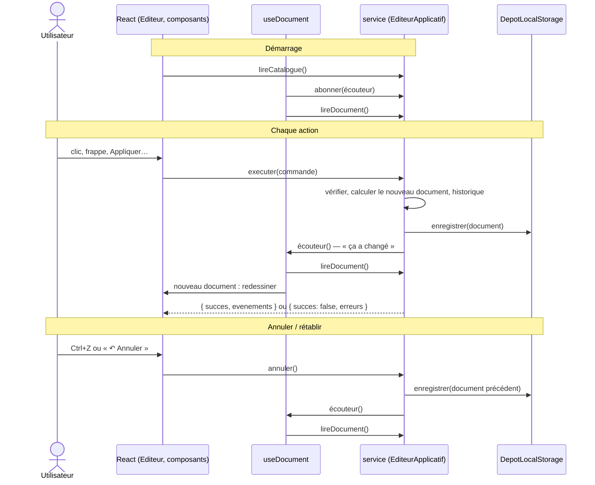

# Tous les appels de React vers le noyau

> 🟢 **Document de RÉFÉRENCE : il décrit l'état ACTUEL du système.**
> Dernière mise à jour : **27/10/2026, état à la fin de la phase 1**.
>
> React ne parle au noyau **que** par l'objet `service`, qui implémente le port entrant `ServiceEditeur`. Ce document liste **tous** ces appels, dit **quand** ils ont lieu et **ce que fait le noyau** en réponse.
> Pour suivre une fonctionnalité de bout en bout, voir aussi [04-fonctionnement-des-fonctionnalites.md](04-fonctionnement-des-fonctionnalites.md).

---

## 1. Le principe : React lit, mais n'écrit jamais lui-même

- React reçoit le document en **lecture seule**. Il ne peut pas le modifier.
- Pour **tout** changement (ajouter, modifier, supprimer, appliquer le JSON…), React **demande** au noyau en envoyant une **commande** (décision D2).
- Le noyau est donc appelé **à chaque action** de l'utilisateur, et pas seulement au démarrage.
- Seul le **catalogue** (Texte, Bouton, Conteneur) n'est lu **qu'une fois**, parce qu'il ne change jamais.

---

## 2. La liste complète : 8 méthodes

| Méthode | Appelée dans | Quand |
|---|---|---|
| `lireCatalogue()` | `Editeur.tsx` (l. 22) | Une fois, au premier affichage |
| `abonner(écouteur)` | `adaptateurs/use-document.ts` (l. 11) | Une fois, au premier affichage |
| `lireDocument()` | `adaptateurs/use-document.ts` (l. 12) | Au premier affichage, puis **après chaque changement** |
| `executer(commande)` | `Editeur.tsx` (l. 35), `composants/VueModelePivot.tsx` (l. 44) | **À chaque action** de l'utilisateur |
| `annuler()` | `Editeur.tsx` (l. 50 : bouton ; l. 67 : Ctrl+Z) | Clic « ↶ Annuler » ou Ctrl+Z |
| `retablir()` | `Editeur.tsx` (l. 55 : bouton ; l. 70 : Ctrl+Y) | Clic « ↷ Rétablir » ou Ctrl+Y |
| `peutAnnuler()` | `Editeur.tsx` (l. 82) | À chaque affichage de la barre |
| `peutRetablir()` | `Editeur.tsx` (l. 85) | À chaque affichage de la barre |

Les numéros de ligne correspondent à l'état du code au 27/10/2026.

---

## 3. Au démarrage

```
main.tsx           crée le service : new EditeurApplicatif(catalogue, new GenerateurUuid(), new DepotLocalStorage(…))
                   └─ le constructeur charge le document (localStorage) ou en crée un neuf
Editeur.tsx        service.lireCatalogue()  → les 3 définitions → la palette affiche « + Texte, + Bouton, + Conteneur »
use-document.ts    service.abonner(…)       → React s'inscrit : « préviens-moi à chaque changement »
use-document.ts    service.lireDocument()   → le document actuel → canevas, arbre et JSON s'affichent
```

| Appel | Ce que fait le noyau |
|---|---|
| `lireCatalogue()` | Renvoie la liste des définitions de composants (`Catalogue.lister()`) |
| `abonner(écouteur)` | Ajoute l'écouteur à son `Set` d'écouteurs. Renvoie une fonction de désabonnement, que React appellera si l'éditeur disparaît |
| `lireDocument()` | Renvoie le document actuel. C'est une simple référence, rien n'est recalculé |

---

## 4. À chaque action de l'utilisateur : `executer(commande)`

C'est **le seul moyen** de modifier le modèle pivot.

### 4.1 Les 6 situations où React l'appelle

| Action à l'écran | Fichier | Commande envoyée |
|---|---|---|
| Clic sur « + Texte / + Bouton / + Conteneur » | `Editeur.tsx` → `ajouter` | `{ type: 'ajouter-noeud', parentId, composant, position? }` |
| Frappe dans un champ du panneau de propriétés | `Editeur.tsx` (prop `onModifier`) | `{ type: 'modifier-propriete', id, nom, valeur }` |
| Clic sur « Supprimer » | `Editeur.tsx` (prop `onSupprimer`) | `{ type: 'supprimer-noeud', id }` |
| « Appliquer » sur le JSON édité | `VueModelePivot.tsx` → `appliquer` | `{ type: 'remplacer-document', document }` |
| « Charger l'exemple » | `Editeur.tsx` | `{ type: 'remplacer-document', document: documentExemple }` |
| « Nouveau document » | `Editeur.tsx` | `{ type: 'remplacer-document', document: documentVide(…) }` |

### 4.2 Ce que fait le noyau, toujours dans le même ordre

Fichier `packages/noyau/src/application/editeur-applicatif.ts`, méthode `executer` :

```
1. VÉRIFIER    appliquerCommande(...) contrôle les règles : le parent existe ? la valeur est permise ?
               le JSON respecte le métamodèle ?
               └─ refusé → renvoie { succes: false, erreurs }, et RIEN ne change
                           (ni document, ni stockage, ni historique, ni notification)

2. CALCULER    un NOUVEAU document ; l'ancien n'est jamais modifié

3. RANGER      l'ancien document va dans la pile #passe (pour Annuler) ; la pile #futur est vidée

4. ENREGISTRER le nouveau document dans le localStorage (port DepotDocument)

5. PRÉVENIR    chaque écouteur, dont React → React rappelle lireDocument() et redessine
```

Si la commande ne change rien (par exemple, retaper la même valeur), le noyau répond « succès » mais **saute les étapes 3 à 5** : pas d'enregistrement, pas de notification, pas d'entrée dans l'historique (décision D18).

### 4.3 Ce que React fait de la réponse

| Réponse | Réaction de React |
|---|---|
| `{ succes: true, evenements }` | Efface les messages d'erreur. Après un ajout, sélectionne le nouveau nœud (son identifiant est dans l'événement `noeud-ajoute`) |
| `{ succes: false, erreurs }` | Affiche les erreurs (code + message). Le dessin ne change pas |

Le **redessin** ne dépend pas de cette réponse : il vient de la **notification** de l'étape 5.

---

## 5. Annuler et rétablir

### 5.1 Les deux piles du noyau

`EditeurApplicatif` garde deux piles de documents :
- `#passe` : les versions **précédentes** ;
- `#futur` : les versions **annulées**, qu'on peut rétablir.

Exemple : on part d'un document vide (A), on ajoute un Texte (B), puis un Bouton (C).

```
                     passé       actuel     futur
Après les ajouts :   [A, B]        C          []
Clic « Annuler » :   [A]           B          [C]     ← C part dans le futur, B redevient l'actuel
Clic « Annuler » :   []            A          [C, B]
Clic « Rétablir » :  [A]           B          [C]     ← B ressort du futur
Nouvelle action D :  [A, B]        D          []      ← une nouvelle action efface le futur
```

### 5.2 Ce que fait le noyau

| Appel | Ce que fait le noyau |
|---|---|
| `annuler()` | 1. prend le dernier document de `#passe` ; 2. met l'actuel dans `#futur` ; 3. fait du document pris l'actuel ; 4. l'**enregistre** et **prévient** React |
| `retablir()` | La même chose, en sens inverse : prend dans `#futur`, met l'actuel dans `#passe` |
| (pile vide) | Répond `{ succes: false }` avec l'erreur `HISTORIQUE_VIDE`. Rien ne change |
| `peutAnnuler()` | Répond `#passe.length > 0`. React s'en sert pour griser ou non le bouton |
| `peutRetablir()` | Répond `#futur.length > 0` |

L'historique garde au plus **100** documents. Ça coûte peu de mémoire : deux versions successives **partagent** tous les nœuds qui n'ont pas changé.

### 5.3 Ce que fait React

Rien de spécial. Il reçoit la notification, relit le document et redessine. **Pour React, annuler est un changement comme un autre.**

Les raccourcis Ctrl+Z / Ctrl+Y sont ignorés quand le curseur est dans un champ de saisie. Là, ils gardent leur sens habituel : annuler la frappe dans le champ.

---

## 6. Schéma récapitulatif


